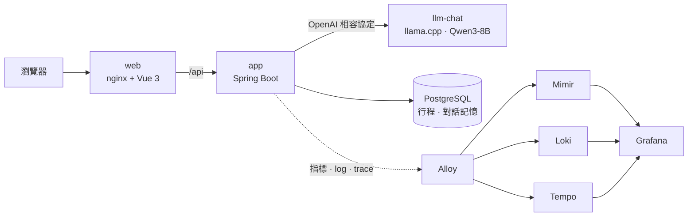

# talkcal

[](https://github.com/Anderson-chen/talkcal/actions/workflows/ci.yml)

用自然語言管行事曆的 AI 助理。跟它說「明天晚上七點和 Amy 吃飯」，它會提議一張行程卡片，你確認後才存；
也能問「這週末有空嗎？」「下週一早上有哪些空檔？」。模型自己架（llama.cpp + Qwen3-8B），不呼叫雲端 API。

這個 repo 是作品集。功能刻意只做一條主線，重點放在**一個產品上線後要顧慮的事**：
架構怎麼守、怎麼觀測、怎麼壓測、怎麼部署。

## 架構



AI 助理是自己寫的 agent loop：每一輪把對話歷史和三個工具交給模型，模型決定要不要呼叫工具，
工具背後是行事曆的 use case。

| 工具 | 做什麼 | 會不會存檔 |
|---|---|---|
| `propose_events` | 把一句話解析成行程，畫面上顯示確認卡片 | 不會：使用者按確認才送 `POST /api/calendar/events` |
| `list_events` | 查一段日期裡的行程 | 不會 |
| `find_free_slots` | 找一段日期、某個時段裡的空檔 | 不會 |

## 目錄

每個資料夾是一個關注點，各自有 README 說明設計理由：

```
backend/   Spring Boot app：程式碼、Gradle、Dockerfile
web/       Vue 3 前端：程式碼、npm、Dockerfile、nginx 設定
deploy/    把 app、前端、模型、資料庫跑起來的 Docker Compose
ops/       觀測：Alloy → Mimir / Loki / Tempo → Grafana
perf/      k6 壓測
ci/        CI 要檢查什麼、在什麼環境檢查
docs/      設計稿
```

## 程式結構

後端（`backend/`）是六角架構（Hexagonal / Ports & Adapters），目錄照 BuckPal 的慣例：

```
io.github.andersonchen.talkcal
├── Application            只負責啟動（留在根 package，元件掃描和測試都從這裡找起）
├── app                    組裝根，代表整個應用程式：業務模組不知道自己被怎麼組起來
│   ├── config             所有 @Configuration，唯一認識具體實作的地方
│   ├── job                排程工作（每天清舊對話）
│   └── observability      全站共用的 access log
└── calendar               行事曆這門業務，一個模組
    ├── application
    │   ├── domain.model     業務規則（CalendarEvent、FreeSlots…），純 Java，不認識 Spring
    │   ├── domain.service   use case 的實作，只呼叫 model 和 port
    │   ├── port.in          use case 介面（外面怎麼使喚核心）
    │   └── port.out         核心需要的外部能力（存取行程、抽行程）
    └── adapter
        ├── in               HTTP controller、AI 助理與它的工具
        └── out              PostgreSQL、Spring AI
```

分層規則寫成 [ArchitectureTest](backend/src/test/java/io/github/andersonchen/talkcal/ArchitectureTest.java)（ArchUnit）：
依賴只能由外往內、core 不准依賴 Spring 和 Jackson、只有組裝根（app.config、app.job）能認識 adapter 的具體類別、模組之間互不 import。違反就紅燈，不靠 code review 記得。

## 技術選型

| 層 | 用什麼 | 為什麼（細節在各目錄的 README 和程式碼註解） |
|---|---|---|
| 後端 | Java 25、Spring Boot 4.1、Spring MVC | |
| 跟模型講話 | Spring AI 2.0（OpenAI 相容協定） | llama-server 講 OpenAI 的協定；哪天換成雲端模型，改設定不改程式 |
| 模型 | llama.cpp + Qwen3-8B（Q4_K_M） | 自架：資料不出機器、沒有 token 費用 |
| 資料庫 | PostgreSQL 18 + Flyway，用 JdbcClient 不用 JPA | 只有兩張表，手寫 SQL 一眼看得懂，domain 物件不必為了 ORM 加註解 |
| 前端 | Vue 3 + TypeScript + Vite | 見 [web/README.md](web/README.md) |
| 觀測 | Grafana Alloy → Mimir / Loki / Tempo → Grafana | 指標、log、trace 三種訊號，互相點得過去。見 [ops/README.md](ops/README.md) |
| 壓測 | k6 | 見 [perf/README.md](perf/README.md) |
| 部署 | Docker Compose（在本機模擬雲端部署） | 見 [deploy/README.md](deploy/README.md) |

## 怎麼跑

需要：Docker（含 NVIDIA GPU 支援）、JDK 25。

> **已知限制**：模型檔目前從寫死的 `C:\llm\models` 複製進容器（`deploy/compose.yaml`），所以只能在 Windows 上照原樣跑。
> 要先把 `Qwen3-8B-Q4_K_M.gguf` 放進那個資料夾。改成可設定的路徑是待辦事項。

```bash
docker compose -f deploy/compose.yaml up -d postgres llm-chat   # 資料庫和模型（第一次要等模型複製、載入）
cd backend && ./gradlew deploy                                  # 跑測試、build 並部署 app 和前端
```

瀏覽器開 <http://localhost:18080>。API 文件（Swagger UI）在 <http://localhost:18090/swagger-ui.html>。

要看觀測：再起 `ops/`（`docker compose --env-file deploy/.env -f ops/compose.yaml up -d`；`--env-file` 帶告警寄信的 SMTP，沒帶 Grafana 會重建成不寄信），Grafana 在 <http://localhost:3000>。

本機開發（不進容器）：

```bash
cd backend && ./gradlew bootRun  # app 在 8090，連 deploy/ 的 PostgreSQL 和模型
npm --prefix web run dev         # 前端在 5173，/api 轉給 8090（在 repo 根目錄跑）
```

## 測試

Gradle 指令都在 `backend/` 裡跑：

```bash
./gradlew test               # 單元測試、web 切片、架構規則：不需要任何外部服務，秒回
./gradlew integrationTest    # 對真的 llama-server 和 PostgreSQL（Testcontainers）；模型沒開就自動跳過那幾支
./gradlew test integrationTest jacocoTestReport   # 加上合併的覆蓋率報告（只找漏測、不設門檻，見 docs/test-coverage.md）
../ci/run.sh                 # 跟 CI 完全一樣：在乾淨的容器裡跑上面全部，再加前端的型別檢查和打包
```

CI 在每次 push、PR 時於 GitHub 上跑，本機則由 pre-push hook 在推之前先跑一次（`git config core.hooksPath .githooks` 啟用）。
兩邊走同一支 `ci/run.sh`、同一個映像檔；GitHub 沒有 GPU，模型測試只在本機會真的跑。設計見 [ci/README.md](ci/README.md)。

## 上線準備怎麼分類

上線之後要顧慮的事照產品的生命週期分成五段，每一段是一個 epic issue，裡面是所有面向的總表：
還沒做完的面向各有子 issue（sub-issue），現況、做法和證據寫在子 issue 裡，狀態以子 issue 的開關為準；已經完成的面向，說明留在 epic。
被問到「上線要注意什麼」時，照這五段走一輪，就不會整塊漏掉。

```
① 能不能上線    ② 怎麼上線      ③ 跑起來之後     ④ 出事的時候     ⑤ 長期活下去
  Ready           Release          Run              Respond          Evolve
  測試/資安/設定   CI/CD/部署/回退   觀測/容量/成本    告警/除錯/復原    升級/資料/文件
                  開發流程
```

| 階段 | epic |
|---|---|
| ① 能不能上線（Ready） | [#8](https://github.com/Anderson-chen/talkcal/issues/8) |
| ② 怎麼上線（Release） | [#17](https://github.com/Anderson-chen/talkcal/issues/17) |
| ③ 跑起來之後（Run） | [#30](https://github.com/Anderson-chen/talkcal/issues/30) |
| ④ 出事的時候（Respond） | [#38](https://github.com/Anderson-chen/talkcal/issues/38) |
| ⑤ 長期活下去（Evolve） | [#46](https://github.com/Anderson-chen/talkcal/issues/46) |

### 分段的依據

五段照**什麼時候最需要它**來切，不照哪個團隊負責、也不照用了哪種技術。這條時間軸跟兩個業界框架的分段對得上，這裡只是把每一段寫成一個問句，判斷時比較好用：

| 段 | 判斷問題（答「是」就放這段） | AWS Well-Architected 營運卓越支柱 | ITIL v3 服務生命週期 |
|---|---|---|---|
| ① Ready | 少了它，這個版本就不該給使用者用嗎？（版本本身對不對、安不安全） | Prepare：Design for operations、Operational readiness | Service Design、Service Transition 的 Validation and Testing |
| ② Release | 它管的是一個改動從開 issue、寫程式、審查到上線、退版的路嗎？ | Prepare：Mitigate deployment risks | Service Transition |
| ③ Run | 沒出事的平常日也要一直看、一直付的嗎？ | Operate：Utilizing workload observability、Understanding operational health | Service Operation（監控） |
| ④ Respond | 出事的那一刻才用得到嗎？ | Operate：Responding to events | Service Operation（事故、問題管理） |
| ⑤ Evolve | 就算不出事，放著不管也會隨時間變糟，或換人、換電腦就接不下去嗎？ | Evolve | Continual Service Improvement |

ITIL 4 已經把 v3 的五段改成不分先後的價值鏈，這裡對照 v3，是因為它的分段最常被拿來講服務的生命週期。

為什麼不像 Mercari 那樣照屬性（Observability、Security…）分：被問到「上線要注意什麼」時，照時間走一輪，比較不會整塊漏掉。改到哪塊技術（CI、前端、資料庫…）改用 `area:` label 標，一張 issue 可以貼好幾個（見 [`.claude/rules/issue.md`](.claude/rules/issue.md)）。

一件事碰到好幾段時：

1. 選**最需要它的那一刻**。例如備份平常就在跑，但真正用到是出事的時候，放 ④（#45）；套件升級要過一段時間才會痛，放 ⑤（#48）。
2. 同一件事有「平常就要有」和「出事時才要做」兩半，就拆成兩張。例如觀測放 ③（#31），告警放 ④（#39）：看得到跟會被叫醒是兩件事。
3. 一張 issue 只放一段（只貼一個 `stage:` label）。
4. 開發流程（issue、分支、審查、CI、給 AI 的規則）是改動必經的路，放 ②；讓之後的人看得懂、跑得起來的（README、ADR、本機環境），放 ⑤。

下面這幾份清單不是用來切段，是用來檢查項目有沒有漏：逐條對照過（2026-10-08），對方有、這裡沒有的都補進來了。

### 參考資料

- [AWS Well-Architected：Operational Excellence Pillar](https://docs.aws.amazon.com/wellarchitected/latest/operational-excellence-pillar/welcome.html)：營運分成 Prepare、Operate、Evolve，Operate 底下再分平常看健康和處理事件，是五段分法的主要對照
- [ITIL v3 服務生命週期](https://en.wikipedia.org/wiki/ITIL)：Strategy、Design、Transition、Operation、Continual Improvement 五段（ITIL 4 已改成價值鏈）
- [Google SRE Book：Launch Coordination Checklist](https://sre.google/sre-book/launch-checklist/)：Google 上線前逐項確認的清單，涵蓋容量、故障演練、相依服務、漸進式發布、監控監控本身
- [Mercari Production Readiness Checklist](https://github.com/mercari/production-readiness-checklist)：公開在 GitHub 上、實際在用的版本。分成 Maintainability、Observability、Reliability、Security、Data Storage，依 SLO 分等級決定要做到哪些
- [AWS Well-Architected Generative AI Lens](https://docs.aws.amazon.com/wellarchitected/latest/generative-ai-lens/generative-ai-lens.html)：把六根支柱套在生成式 AI 的生命週期上（選模型、prompt、整合、部署、持續改進）
- [OWASP Top 10 for LLM Applications 2025](https://genai.owasp.org/llm-top-10/)、[OWASP Top 10 for Agentic Applications 2026](https://genai.owasp.org/resource/owasp-top-10-for-agentic-applications-for-2026/)：LLM 和 agent 特有的資安風險。epic 裡 `LLM01` 這類編號指的就是這兩份
- [trunkbaseddevelopment.com](https://trunkbaseddevelopment.com/)、[Git Flow 原文與作者 2020 年的補註](https://nvie.com/posts/a-successful-git-branching-model/)：分支策略和 hotfix 該怎麼選
- [AGENTS.md](https://agents.md/)、[DORA](https://dora.dev/)：用 AI 寫程式時，規則怎麼跟著 repo 走、怎麼量 AI 對交付的影響
- [GitHub：Linking a pull request to an issue](https://docs.github.com/en/issues/tracking-your-work-with-issues/using-issues/linking-a-pull-request-to-an-issue)、[Projects 內建自動化](https://docs.github.com/en/issues/planning-and-tracking-with-projects/automating-your-project/using-the-built-in-automations)：`Closes #N` 怎麼讓合併自動關 issue、看板怎麼自己轉狀態
- [Atlassian：Integrate Jira with GitHub](https://support.atlassian.com/jira-cloud-administration/docs/integrate-with-github/)：issue key 寫進分支、commit、PR，Jira 就會把開發進度連回 issue（原本的規劃，後來改用 GitHub Issues）
- [HikariCP：Dropwizard / Micrometer metrics](https://github.com/brettwooldridge/HikariCP/wiki/Dropwizard-Metrics)、[Spring Boot：Supported metrics（DataSource）](https://docs.spring.io/spring-boot/reference/actuator/metrics.html)：連線池有哪些指標可以看
- [Grafana：Trace correlations](https://grafana.com/docs/grafana/latest/datasources/tempo/configure-tempo-data-source/)、[Tempo：metrics-generator（service graph）](https://grafana.com/docs/tempo/latest/metrics-generator/service_graphs/)：在 Grafana 裡把指標、log、trace 串起來

## 產品範圍怎麼分類

上線準備的五段回答「怎麼做到」；產品範圍回答「要做到什麼」：只有行事曆加 AI 助理才會這樣問、要看使用者要什麼才能決定的事。
分成八個面向，每個面向是一個 epic issue（標 `epic` 和 `product: 面向`），裡面列細項的現況；決定要做的才拆成子 issue，決定不做的在 epic 裡寫理由。

| 面向 | 要回答的問題 | 對應的機制（上線準備） | epic |
|---|---|---|---|
| 時間解讀 | 使用者說的時間、看到的時間，在各種情境下都是同一個意思嗎 | #46 時區（儲存） | [#189](https://github.com/Anderson-chen/talkcal/issues/189) |
| 同時操作 | 同時操作時，使用者看到的結果合理嗎 | #50 並行修改、#51 冪等寫入、#187 排程工作只執行一次 | [#190](https://github.com/Anderson-chen/talkcal/issues/190) |
| 行程管理 | 行程從建立、修改、提醒到刪除，使用者需要的每一步都有嗎 | | [#191](https://github.com/Anderson-chen/talkcal/issues/191) |
| 資料互通 | 資料進得來、出得去、能跟別人和其他行事曆共用嗎 | #11 認證與授權 | [#192](https://github.com/Anderson-chen/talkcal/issues/192) |
| 多語系 | 換一種語言、換一個地方的人還能用嗎 | | [#193](https://github.com/Anderson-chen/talkcal/issues/193) |
| AI 助理使用規則 | 使用者能信任它、成本控制得住、答錯時有回饋管道嗎 | #12 濫用防護、#35 成本、#36 產品指標 | [#194](https://github.com/Anderson-chen/talkcal/issues/194) |
| 帳號與個資 | 使用者能完整掌控自己的帳號和資料，也符合法規嗎 | #52 隱私 | [#195](https://github.com/Anderson-chen/talkcal/issues/195) |
| 回應速度 | 使用者覺得快嗎，而不只是後端的數字 | #34 SLO、③ Run 的壓測與容量 | [#196](https://github.com/Anderson-chen/talkcal/issues/196) |

### 面向的依據

八個面向是從「用行事曆加 AI 助理的人會問什麼」整理出來的，再拿 [ISO/IEC 25010:2023](https://quality.arc42.org/articles/iso-25010-update-2023) 的九個產品品質特性對照，確認沒有整塊漏掉：

| ISO 25010 特性 | 對到的面向 |
|---|---|
| Functional suitability（功能完整、正確） | 時間解讀、行程管理 |
| Performance efficiency | 回應速度 |
| Compatibility（互通） | 資料互通 |
| Interaction capability（好不好用、包容性） | 多語系、AI 助理使用規則 |
| Reliability | 同時操作 |
| Security | 帳號與個資 |
| Flexibility（可攜、擴展） | 資料互通 |
| Safety | AI 助理使用規則（答錯時的回饋管道） |
| Maintainability | 沒有：要問工程才能決定，放上線準備的 ⑤ Evolve |

判斷一個新問題放哪個面向：

1. 看它回答的是表格裡哪個「要回答的問題」，一張 issue 只貼一個 `product:` label。
2. 哪個都回答不了，而且已經想得到三件以上的細項，才開新的面向（新的 epic 和 `product:` label，README 表格、label 說明、epic 標題用同一個名字）；不到三件就先放進最接近的面向，免得 epic 底下只有一兩件、只是多一層。

### 跟上線準備怎麼分

兩者是看同一個產品的兩個角度，不是第六段：

| | 上線準備（五段） | 產品範圍（八個面向） |
|---|---|---|
| 角度 | 工程與營運面 | 產品面 |
| 回答 | 怎麼做到：怎麼把它做穩、顧好 | 要做到什麼 |
| 誰決定 | 工程，有業界標準做法 | 產品，看使用者要什麼 |
| 換一個產品 | 大部分照搬 | 幾乎全部重想 |

新的面向放哪邊，只問一句：**這件事要問誰才能決定？** 兩邊都沾到的不選邊，拆成兩項：機制放上線準備、規則放產品範圍，互相連結。
例如時區：「存下來不會被資料庫偷偷換算」是機制，在 #46；「要支援哪些時區、出國時顯示哪裡的時間」是規則，在 #189。
同理，限流（擋濫用）和方案配額（免費一天幾次）、量出成本和依成本定價，都是一邊一項。

這條線不等於「非功能需求」和「功能需求」：「使用者能接受等多久」是效能、算非功能需求，但要問使用者才能決定，所以放產品範圍。

## 文件地圖

| 想知道 | 看哪裡 |
|---|---|
| 整體架構圖：本機兩組 compose 怎麼接 | [docs/architecture.md](docs/architecture.md) |
| AWS 階段一互動架構圖：每個元件由哪個檔案哪幾行決定、為什麼這樣選、業界怎麼做 | [https://anderson-chen.github.io/talkcal/](https://anderson-chen.github.io/talkcal/)（原始檔 [docs/architecture/index.html](docs/architecture/index.html)） |
| 搬上 AWS 的兩個階段（EC2、EKS） | [infra/README.md](infra/README.md) |
| 怎麼部署、容器之間怎麼溝通、對照雲端是什麼 | [deploy/README.md](deploy/README.md) |
| 怎麼觀測、三種訊號怎麼互跳 | [ops/README.md](ops/README.md) |
| 怎麼壓測、怎麼讀結果 | [perf/README.md](perf/README.md) |
| 每個請求花多少錢、自架 GPU 和 Bedrock 在哪裡交叉 | [docs/cost.md](docs/cost.md) |
| CI 怎麼跑、為什麼在容器裡跑 | [ci/README.md](ci/README.md) |
| 套件怎麼自動升級、升級 PR 怎麼審 | [docs/dependency-updates.md](docs/dependency-updates.md) |
| 測試覆蓋率怎麼看、為什麼不設門檻 | [docs/test-coverage.md](docs/test-coverage.md) |
| 前端怎麼組成 | [web/README.md](web/README.md) |
| 畫面設計稿和實作的差異 | [docs/design/calendar/README.md](docs/design/calendar/README.md) |
| 資料表為什麼長這樣 | [backend/src/main/resources/db/migration](backend/src/main/resources/db/migration)（每支 SQL 開頭都寫了理由） |
