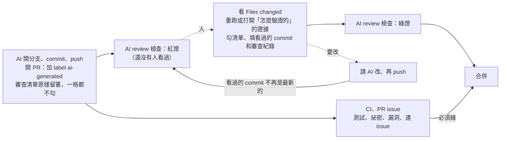

# AI 改動的人工審查

這個 repo 的程式碼幾乎都是 AI（Claude Code）寫的。CI 證明「測試過了」，這份文件和它的檢查要證明的是另一件事：
**每個 AI 寫的 PR，都有人看過 diff、核對過 AI 說的驗證結果，而且看過的紀錄留在 PR 上。**

## 流程



1. **AI 開 PR**：照 [PR 範本](../.github/pull_request_template.md)，加 label `ai-generated`，「AI 改動審查」那段原樣留著（規則寫在 [CLAUDE.md](../CLAUDE.md)）。
2. **檢查是紅的**：[ai-review.yml](../.github/workflows/ai-review.yml) 看到清單沒勾就紅燈 —— 「還沒有人看過」變成 PR 上看得到的狀態，不靠記得。
3. **人審查**：看 diff、核對證據、勾清單，填「審查到的 commit」和一行「審查紀錄」。
4. **又 push 了就重看**：「審查到的 commit」不是 PR 最新的 commit 就紅燈 —— 看過的 diff 已經不是要合併的 diff。
5. **綠燈才合併**。

人寫的 PR 改成 label `human-written`，不需要清單。兩個都沒標也是紅燈：不標示的話，「這是 AI 寫的」這件事就消失了。

## 清單每一項在防什麼

| 項目 | 防的是 AI 的哪種毛病 |
|---|---|
| diff 每個檔案都看過，說得出為什麼要改 | 讀 PR 描述就以為懂了；AI 的描述寫得比實際改的完整 |
| 「怎麼驗證的」至少一項自己重跑或打開證據核對過 | AI 說「312 題全過」「已部署驗證」，沒有人確認過這句話 |
| 沒有超出 issue 範圍的改動 | AI 順手重構、改了不相干的檔案，混進同一個 PR 裡沒人注意 |
| 測試真的會擋：有反例 | 測試寫成永遠綠（斷言太鬆、mock 掉了要測的東西） |
| 產品角度沒有洩漏內部設定 | AI 照 repo 公開的思路，把 system prompt、工具名稱放進使用者看得到的回應或錯誤訊息 |
| 新加的依賴、權限都是必要的 | 為了讓東西跑起來，順手把權限開大（workflow `write-all`、IAM `*`、CORS `*`） |

不適用的項目也勾，在審查紀錄寫為什麼不適用。不能刪：檢查會數項目數，「不想勾的就刪掉」不會過。

## 改這個之前缺什麼（證據）

到 2026-10-16，`master` 已合併 44 個 PR，**沒有一個有審查紀錄**：

```bash
gh pr list --state merged --limit 200 --json number,reviews,comments \
  --jq '[.[] | select((.reviews|length) + (.comments|length) > 0)] | length'   # → 0
```

流程本身是對的 —— 2026-10-12 起有 ruleset `protect-master`（一定走 PR、CI 和 PR issue 必須綠、管理員也不能繞過），
[#1](https://github.com/Anderson-chen/talkcal/pull/1) 是套用規則之後的第一個 PR。但審查只發生在對話裡，合併之後什麼都沒留下：

| 從 PR 上看不出來的事 | 例子 |
|---|---|
| 哪些 PR 是 AI 寫的 | 依使用者的規則，commit 和 PR 描述都不寫 AI 署名，所以 44 個 PR 看起來都像人寫的 |
| 有沒有人看過 diff | [#128](https://github.com/Anderson-chen/talkcal/pull/128)：11 個檔案、+144/−33，開 PR 之後 17 分鐘合併，PR 上沒有任何審查痕跡 |
| AI 說的驗證有沒有人核對 | #128 寫「test + integrationTest 312 題全過」「部署到 EC2，app、web、postgres 都 healthy」—— 全是 AI 自己的描述 |
| 「合併前要做完」的事做了沒 | #128 寫「雲端 Google 實際登入，合併前做完」，17 分鐘後合併，從 PR 上不知道做了沒有 |
| 看過的是不是最後那一版 | 看完之後又 push，沒有東西會提醒 |

這次之後，同樣的問題在 PR 上都有答案：label 說誰寫的，清單和審查紀錄說看了什麼，「審查到的 commit」說看的是哪一版。
這個 PR（#28 的實作）本身是第一個走這套流程的 PR：開好時 AI review 是紅的，使用者審查、勾完才變綠。

## 業界怎麼做（2026）

| 做法 | 例子 | 這裡怎麼做 |
|---|---|---|
| 揭露 AI 參與 | 一份 2026 年的研究看了 1,000 個熱門 GitHub repo 的 118 份 AI 政策：51% 要求揭露、74% 要求人在迴圈裡（[arXiv 2605.16706](https://arxiv.org/abs/2605.16706)）；Kubernetes、Kyverno、EFF 都要求在 PR 描述揭露 | label `ai-generated`，不寫在描述或 commit（理由見下一節） |
| 不用 AI 署名 trailer | Kubernetes 禁止把 AI 列成 commit co-author、加 AI attribution trailer，人要為每一行負責（[Kubernetes 部落格，2026-06](https://kubernetes.io/blog/2026/06/26/open-source-maintainership-in-the-age-of-ai/)） | 一樣：commit 沒有 Co-Authored-By，負責的是合併的人 |
| 作者要能解釋、要跑過測試 | Actual Budget：要懂自己的程式碼、跑過測試、把 AI 寫的描述刪到跟程式碼相符（[AI usage policy](https://actualbudget.org/docs/contributing/ai-usage-policy)）；Apache Fory：審查時要能說明設計（[AI_POLICY.md](https://apache.googlesource.com/fory/+/refs/heads/main/AI_POLICY.md)） | 清單第 1、2 項 |
| 標示要改變審查路徑才有用 | 只貼「AI 產生」label 沒有用，要讓它觸發不同的審查、必過的檢查（[AI coding team workflow policy guide, 2026](https://www.kunalganglani.com/blog/ai-coding-team-workflow-policy-guide.md)） | `ai-generated` 會觸發清單檢查；`human-written` 不會 |
| AI review 當第一道、人當最後一道 | Copilot code review、Claude Code 的 code review 這類工具跑第一輪，人做最後核准；AI 的意見是給審查者的輸入，不取代審查（[webreference](https://webreference.com/ai/building/ai-code-review/)、[審查清單，2026](https://aicodereview.cc/blog/how-to-review-ai-generated-code)） | 沒有接進 CI（見「刻意不做的」）；本機可以用 Claude Code 的 `/code-review` 跑一輪，結果寫進審查紀錄 |

## 取捨

### 為什麼用 label，不寫在描述或 commit

使用者的規則是 commit 訊息不放 `Co-Authored-By: Claude`、PR 描述不放「Generated with Claude Code」。
這兩個是工具預設加的署名，放在每一個 commit、每一個 PR 裡只是雜訊，而且 Kubernetes 這類專案也明文不要。

但不放署名，「AI 寫的」這件事就從 repo 消失了。label 補上這一塊：

- **查得到**：`gh pr list --label ai-generated`、GitHub 搜尋 `is:pr label:ai-generated`
- **不弄髒歷史**：commit 訊息、`git log` 保持乾淨；label 是 PR 的中繼資料，不進 git
- **會觸發檢查**：標了 `ai-generated` 才要清單，沒標就紅燈，不會因為忘了標而跳過

### 為什麼審查紀錄寫在 PR 描述，不是用 GitHub 的 Approve

GitHub 不讓作者核准自己的 PR。這個 repo 只有一個人，PR 是 AI 用使用者的帳號開的，所以「作者」就是使用者，
`required_approving_review_count` 只能是 0（[#1](https://github.com/Anderson-chen/talkcal/pull/1) 的決定）。
清單和審查紀錄寫在描述裡，同一個帳號也能填，而且描述的每次修改 GitHub 都有編輯紀錄（描述右上角的 edited）。

### 擋不住什麼

**AI 和人用的是同一個 GitHub 帳號，檢查分不出格子是誰勾的。** AI 也可以自己勾完、自己填紀錄，檢查一樣會綠。
這道檢查防的是「忘了審」和「審完又 push」，防不了 AI 刻意繞過 —— 那靠的是 CLAUDE.md 的規則：AI 一格都不准勾。

要真的補起來：讓 AI 用**自己的帳號**開 PR（GitHub App 或 machine user），作者就不是使用者，
ruleset 就能設成核准數 1、使用者用 Approve 審查。這個 repo 現在沒這樣做：
要另外管一組 token、每台跑 AI 的機器都要換設定，對一個人的作品集來說，CLAUDE.md 規則 ＋ 這道檢查 ＋ 編輯紀錄已經足夠說明「有人看過」。

## 建議的 GitHub 設定（還沒套用）

`ai-review` 目前**不是必過檢查**：ruleset 是帳號層級的設定，這個 PR 不動它。合併之後，在 ruleset `protect-master` 的
required status checks 加上 `ai-review`，紅燈時合併按鈕才真的按不下去：

```bash
gh api repos/Anderson-chen/talkcal/rules/branches/master \
  --jq '.[] | select(.type=="required_status_checks") | .parameters.required_status_checks[].context'
# 現在：checks、pr-issue、secrets、vulns
```

順序：先合併這個 PR（`ai-review` 要先在 master 上跑過，ruleset 才選得到），再加進必過檢查。
還沒合併的 PR 要補上 label 和清單，不然加進去之後都會擋住。

## 刻意不做的

- **CI 上跑自動化的 AI review**（Copilot code review、Claude Code GitHub Action、CodeRabbit）：要 API key 或付費方案，
  公開 repo 的 PR 會用到這組 key；而且 AI 寫、AI 審，人還是要看最後一道。現在用本機的 `/code-review` 當第一道，結果寫進審查紀錄。
- **用 regex 從 diff 猜是不是 AI 寫的**：猜不準，而且標示本來就該是開 PR 的人的責任。
- **把清單放進 `ci/checks.sh`**：PR 只有 GitHub 上才有，本機 push 時還沒有 PR（跟 PR issue 檢查同一個理由，見 [ci/README.md](../ci/README.md)）。

## 檔案

| 檔案 | 做什麼 |
|---|---|
| `.github/pull_request_template.md` | 「AI 改動審查」段落：6 項清單、審查到的 commit、審查紀錄 |
| `.github/workflows/ai-review.yml` | 什麼時候檢查：開 PR、改描述、push、改 label |
| `.github/ai-review.sh` | 檢查規則：label、清單有沒有勾滿、commit 是不是最新的、紀錄有沒有填 |
| `.github/ai-review.test.sh` | 規則的反例（16 個）；workflow 每次先跑這支，本機跑 `bash .github/ai-review.test.sh` |
