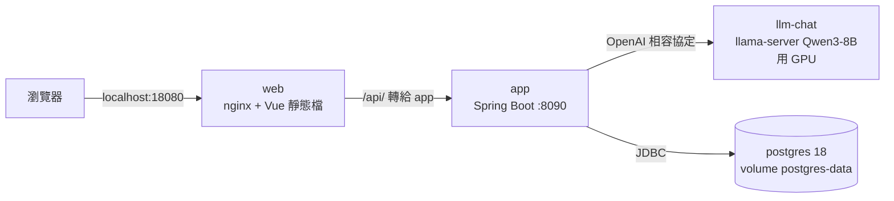
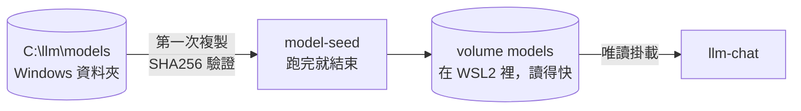
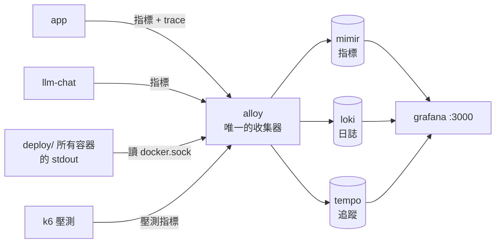
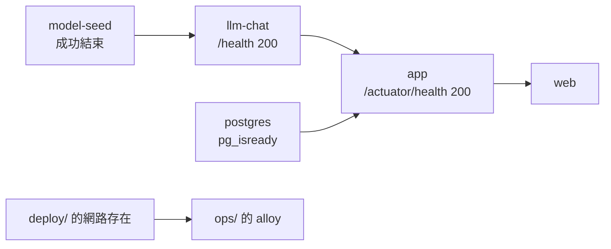
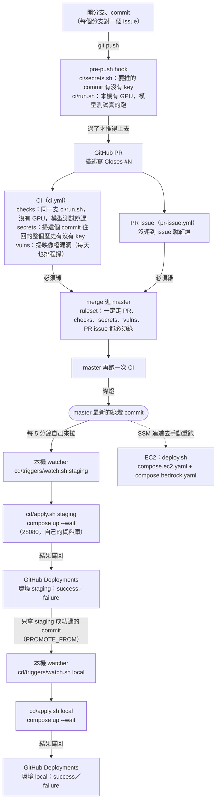

# 架構圖

這份畫的是本機架構，和一個改動怎麼一路到線上（[CI/CD](#cicd從-commit-到線上)）。AWS 各階段的架構圖放在 `infra/` 各階段的資料夾裡，跟部署設定放在一起：

| | 跑在哪 | 追蹤 | 換來什麼 |
|---|---|---|---|
| 本機（這份） | 自己的電腦，兩組 compose | 已完成 | 整套能一鍵起來、看得到三種訊號 |
| [AWS 階段一](../infra/envs/1-ec2/README.md) | 一台 EC2，同樣兩組 compose；模型走 Bedrock（GPU 配額被拒）。2026-10-14 部署上線 | [#57](https://github.com/Anderson-chen/talkcal/issues/57) | 服務真的在線上，別人連得到；compose 幾乎不用改 |
| [AWS 階段二](../infra/envs/2-eks/README.md) | EKS 叢集 | [#58](https://github.com/Anderson-chen/talkcal/issues/58)（前一步是本機 k8s，[#56](https://github.com/Anderson-chen/talkcal/issues/56)） | 換版不停機、一台掛了不會全停 |

為什麼分兩個階段見 [infra/README.md](../infra/README.md)。階段一另有一張可以點的互動圖：[https://anderson-chen.github.io/talkcal/](https://anderson-chen.github.io/talkcal/)（原始檔在 [architecture/index.html](architecture/index.html)）。

## 本機：兩組 Docker Compose

本機用兩組 compose 分開管：`deploy/` 是**被觀測的服務**，`ops/` 是**觀測工具**。
兩組各有自己的網路，Alloy 額外加入 `deploy/` 的網路，才能用服務名稱直接抓 `app:8090`、`llm-chat:8080`。

下面拆成三張小圖，每張只講一件事。

### 1. 一個請求怎麼走

### 2. 模型檔怎麼進容器

### 3. 觀測資料怎麼流

箭頭是**資料流向**。指標其實是 Alloy 去抓（拉），trace 和 k6 的指標是對方推過來，但資料都是往右流。

開發時另外有一個不在容器裡的 bootRun（主機 8090），直接連 `127.0.0.1` 上的模型和資料庫，trace 送主機的 4318；它不在 deploy/ 的網路裡，所以指標和 log 不會被 Alloy 收。

### 啟動順序（depends_on 擋住的）

`ops/` 一定要在 `deploy/` 之後起：Alloy 要加入的網路是 `deploy/` 建的，不存在時起不來。

### 主機上開了哪些埠

全部只綁 `127.0.0.1`，區網的人連不到。Grafana 和 Loki 以前沒綁位址，搬上 EC2 前改掉了（Grafana 匿名就是 Admin）。

| 埠 | 誰 | 給誰用 |
|---|---|---|
| 18080 | web（nginx） | 瀏覽器，唯一的入口 |
| 18090 | app（容器版） | k6 直接壓 app，不想多經過 nginx |
| 28080、28090 | staging 的 web、app | 新版先在這裡驗過才晉升到 18080（[deploy/README.md「環境分層」](../deploy/README.md#環境分層dev--staging--正式)）；staging 的資料庫不對主機開埠 |
| 8090 | bootRun（不在容器裡） | 開發時跟容器版同時開著比對 |
| 8080 | llm-chat | bootRun 的 app 打模型 |
| 5432 | postgres | bootRun 的 app、psql、IDE |
| 4318 | alloy | bootRun 送 trace、k6 送指標 |
| 3000 | grafana | 看儀表板 |
| 9009 | mimir | 直接 curl 查 PromQL |
| 12345 | alloy | 除錯頁，看管線圖 |

細節（為什麼這樣設）寫在 [deploy/compose.yaml](../deploy/compose.yaml)、[ops/compose.yaml](../ops/compose.yaml) 的註解裡。

## CI/CD：從 commit 到線上

一個改動從開分支到跑在線上，經過的每一關。實線是自動發生的，虛線是人做的。

本機是 **pull**：GitHub 不必有任何連進這台電腦的權限，機器自己去看 CI 綠了沒（理由見 [cd/README.md](../cd/README.md#為什麼是-pull)）。
EC2 目前是手動部署：機器平常關機，展示前開機、需要時用 SSM 重跑 `deploy.sh`。

### 每一關擋什麼、擋不住什麼

| 關卡 | 擋什麼 | 擋不住什麼 |
|---|---|---|
| pre-push（[ci/](../ci/README.md)） | 本機就會壞的，包括要 GPU 的模型測試；要推的 commit 裡有 key | `git push --no-verify` 可以跳過 |
| GitHub push protection | 推上來的 commit 裡有各家服務的 key（AWS、OpenAI…） | 通用格式的 token；可以在 GitHub 上填理由放行 |
| CI（GitHub Actions） | 乾淨環境才會壞的：「我電腦上可以」；歷史裡任何地方有 key；lint 錯誤（Error Prone、ESLint，見 [ci/README.md](../ci/README.md#lint)） | 模型相關（沒有 GPU）；key 到這裡才抓到時已經公開，只能作廢重發 |
| CI 的 `vulns`（漏洞掃描） | 映像檔裡有已知、可修的 HIGH/CRITICAL 漏洞；每天排程掃，抓合併之後才公布的 | 上游還沒修的、MEDIUM 以下；寫進忽略清單的（有到期日） |
| PR issue | 沒連到 issue 的 PR：合併按鈕按不下去 | 連到的 issue 對不對（只檢查有沒有連） |
| ruleset（protect-master） | 直推 master、force push、刪 master、checks、secrets、vulns 或 PR issue 沒綠就合併、分支落後 master | — |
| staging 先部署（[#24](https://github.com/Anderson-chen/talkcal/issues/24)） | 在 staging 就起不來的版本不會被晉升到正式 | 只驗到 healthcheck；跟正式同一台機器、共用模型，資源和模型參數的問題驗不到 |
| `compose up --wait` | 起不來的容器（healthcheck 沒過） | 起得來但功能壞了：例如模型名稱送錯（[#76](https://github.com/Anderson-chen/talkcal/issues/76)），容器 healthy、第一個 AI 請求才 404 |
| watcher 同一個 commit 只試一次 | 壞掉的版本每 5 分鐘重 build | watcher 自己掛掉（沒有「多久沒部署」告警，決定不做） |

### 檔案

| 層 | 回答的問題 | 檔案 |
|---|---|---|
| 檢查內容 | 要驗什麼 | `ci/checks.sh` |
| 檢查環境 | 在什麼環境驗 | `ci/Dockerfile` |
| CI 入口 | 什麼時候驗 | `.githooks/pre-push`、`.github/workflows/ci.yml`（都呼叫 `ci/run.sh`） |
| 部署步驟 | 怎麼把版本放上機器 | `cd/apply.sh`（本機）、`infra/envs/1-ec2/deploy.sh`（EC2，還沒收進 `cd/`） |
| 環境差異 | 環境之間差在哪 | `cd/envs/local.env`、`cd/envs/staging.env` + `deploy/compose.staging.yaml`、`infra/envs/1-ec2/compose.*.yaml`；有沒有隔開：`cd/check-isolation.sh` |
| CD 入口 | 什麼時候部署 | `cd/triggers/watch.sh` + 工作排程（本機）；手動（EC2） |
| 生機器 | 機器從哪來 | `infra/`（Terraform） |

原則只有一條：**做什麼只寫一次，入口可以很多個**。CI 和 CD 都是這樣分。
