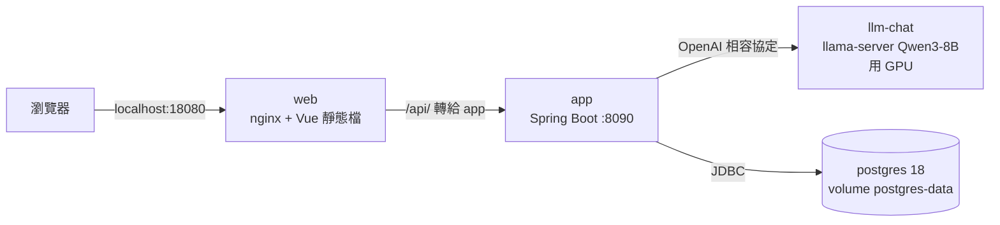
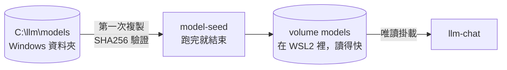
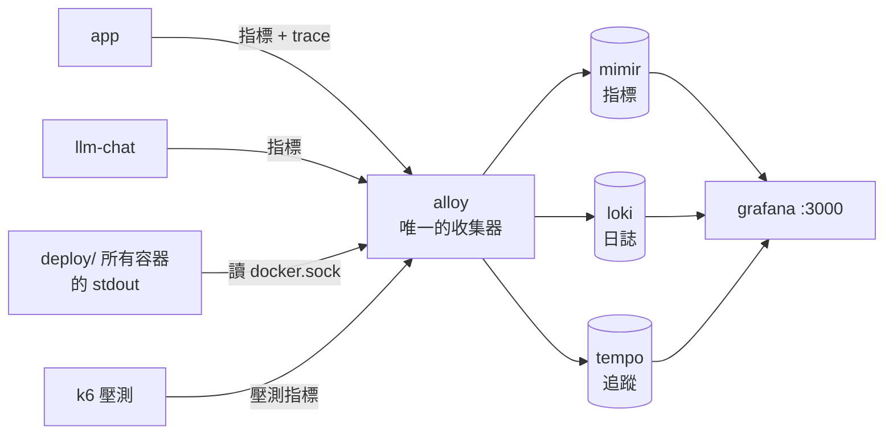
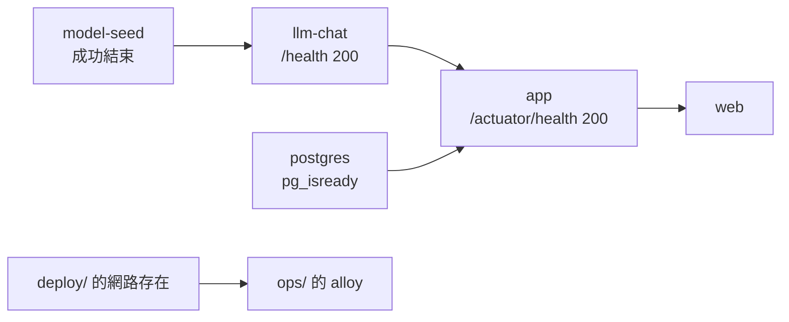

# 架構圖

這份畫的是**現在跑得起來的**本機架構。搬上 AWS 的兩個階段還沒做，架構圖和規劃放在 `infra/` 各階段的資料夾裡，跟之後的部署設定放在一起：

| | 跑在哪 | 追蹤 | 換來什麼 |
|---|---|---|---|
| 本機（這份） | 自己的電腦，兩組 compose | 已完成 | 整套能一鍵起來、看得到三種訊號 |
| [AWS 階段一](../infra/envs/1-ec2/README.md) | 一台 EC2，同樣兩組 compose；模型先走 Bedrock（GPU 配額被拒），配額下來可切回自己跑 | [#57](https://github.com/Anderson-chen/talkcal/issues/57) | 服務真的在線上，別人連得到；compose 幾乎不用改 |
| [AWS 階段二](../infra/envs/2-eks/README.md) | EKS 叢集 | [#58](https://github.com/Anderson-chen/talkcal/issues/58)（前一步是本機 k8s，[#56](https://github.com/Anderson-chen/talkcal/issues/56)） | 換版不停機、一台掛了不會全停 |

為什麼分兩個階段見 [infra/README.md](../infra/README.md)。

## 本機：兩組 Docker Compose

本機用兩組 compose 分開管：`deploy/` 是**被觀測的服務**，`ops/` 是**觀測工具**。
兩組各有自己的網路，Alloy 額外加入 `deploy/` 的網路，才能用服務名稱直接抓 `app:8090`、`llm-chat:8080`。

下面拆成三張小圖，每張只講一件事。

### 1. 一個請求怎麼走

### 2. 模型檔怎麼進容器

### 3. 觀測資料怎麼流

箭頭是**資料流向**。指標其實是 Alloy 去抓（拉），trace 和 k6 的指標是對方推過來，但資料都是往右流。

開發時另外有一個不在容器裡的 bootRun（主機 8090），直接連 `127.0.0.1` 上的模型和資料庫，trace 送主機的 4318；它不在 deploy/ 的網路裡，所以指標和 log 不會被 Alloy 收。

### 啟動順序（depends_on 擋住的）

`ops/` 一定要在 `deploy/` 之後起：Alloy 要加入的網路是 `deploy/` 建的，不存在時起不來。

### 主機上開了哪些埠

全部只綁 `127.0.0.1`，區網的人連不到（Loki 3100、Grafana 3000 例外，沒有綁定位址）。

| 埠 | 誰 | 給誰用 |
|---|---|---|
| 18080 | web（nginx） | 瀏覽器，唯一的入口 |
| 18090 | app（容器版） | k6 直接壓 app，不想多經過 nginx |
| 8090 | bootRun（不在容器裡） | 開發時跟容器版同時開著比對 |
| 8080 | llm-chat | bootRun 的 app 打模型 |
| 5432 | postgres | bootRun 的 app、psql、IDE |
| 4318 | alloy | bootRun 送 trace、k6 送指標 |
| 3000 | grafana | 看儀表板 |
| 9009 | mimir | 直接 curl 查 PromQL |
| 12345 | alloy | 除錯頁，看管線圖 |

細節（為什麼這樣設）寫在 [deploy/compose.yaml](../deploy/compose.yaml)、[ops/compose.yaml](../ops/compose.yaml) 的註解裡。
