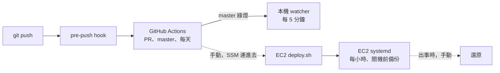

# 自動化腳本地圖

repo 裡每一支腳本：什麼時候跑、誰叫它、做什麼。照一個改動從寫好到上線、再到出事的順序排。
每支腳本的參數和設計理由寫在它自己的開頭註解，這裡只負責「找得到」。

手動跑的幾乎都收進根目錄的 [justfile](../justfile)（`just` 列出全部），表格裡的「just」欄就是對應的指令；
空白的是只由別的腳本、排程或 GitHub 叫，不給人直接用。

## 1. push 之前（本機）

由 [.githooks/pre-push](../.githooks/pre-push) 在每次 `git push` 前自動跑（`git config core.hooksPath .githooks` 啟用一次）。

| 腳本 | 做什麼 | 誰叫 | just |
|---|---|---|---|
| [ci/secrets.sh](../ci/secrets.sh) | gitleaks 掃要推出去的 commit 有沒有 key | pre-push（只掃還沒推的）、CI（整個歷史） | `just secrets` |
| [ci/run.sh](../ci/run.sh) | 在乾淨的容器裡跑 `ci/checks.sh`；改到 prompt、模型相關檔案時加跑 AI eval | pre-push、CI 的 `checks`、手動 | `just ci` |
| [ci/checks.sh](../ci/checks.sh) | CI 要檢查什麼的唯一定義：ShellCheck、後端測試和 Error Prone、前端 lint、測試、型別檢查、打包、E2E | `ci/run.sh`（在容器裡） | |
| [ci/licenses.sh](../ci/licenses.sh) | 前端會打包出去的套件不能是 GPL、AGPL | `ci/checks.sh` | |

## 2. PR、master（GitHub Actions）

| workflow | 什麼時候 | 跑哪些腳本 |
|---|---|---|
| [ci.yml](../.github/workflows/ci.yml) | 每個 PR、push 到 master | `checks`：`ci/run.sh`；`secrets`：`ci/secrets.sh HEAD`；`migrations`：`ci/migrations.sh`；`rules`：`ci/rules.sh`；`sast`：`ci/sast.sh`；`vulns`：`ci/vulns.sh` + `ci/compose-images.sh` |
| ci.yml（排程） | 每天台灣 09:00 | 只跑 `vulns`：程式沒變，新的 CVE 也會冒出來 |
| [alerting.yml](../.github/workflows/alerting.yml) | PR 改到告警規則、Mimir、Alloy、`ops/compose.yaml`；或手動 | `ci/alerting.sh` |
| [pr-issue.yml](../.github/workflows/pr-issue.yml) | PR 開啟、編輯、更新 | 沒有腳本：檢查描述有沒有 `Closes #N` |
| [pages.yml](../.github/workflows/pages.yml) | push 到 master 且改到 `docs/architecture/` | 沒有腳本：把互動架構圖發到 GitHub Pages |

| 腳本 | 做什麼 | just |
|---|---|---|
| [ci/migrations.sh](../ci/migrations.sh) | 舊的 migration 不能改；新的過 squawk，新舊版本同時在線不會壞 | `just migrations` |
| [ci/rules.sh](../ci/rules.sh) | promtool 檢查 Mimir 錄製規則的語法，並用假資料驗算 SLO、burn rate | `just rules` |
| [ci/sast.sh](../ci/sast.sh) → [ci/sast/analyze.sh](../ci/sast/analyze.sh) | CodeQL 掃自己寫的程式（Java、TypeScript、workflow） | |
| [ci/vulns.sh](../ci/vulns.sh) | Trivy 掃映像檔漏洞和 Dockerfile、compose、Terraform 的危險設定 | `just vulns <映像檔>` |
| [ci/compose-images.sh](../ci/compose-images.sh) | 從 compose 列出 EC2 上會跑的第三方映像檔，交給 `vulns.sh` | |
| [ci/alerting.sh](../ci/alerting.sh)（+ [ci/alerting/fake-app.py](../ci/alerting/fake-app.py)） | 告警端到端：真的造出問題，確認信寄得出來，約 15 分鐘 | `just alerting` |
| [ci/format.sh](../ci/format.sh) | Spotless 檢查改過的 Java 檔格式。**目前沒接上**：`backend/build.gradle` 沒有 Spotless，CI、pre-push 也沒呼叫 | `just format` |

## 3. 部署、發版、退版

本機是 pull：機器自己去看 master 有沒有新的綠燈版本（理由見 [cd/README.md](../cd/README.md)）。EC2 目前手動部署。

| 腳本 | 做什麼 | 誰叫 | just |
|---|---|---|---|
| [cd/triggers/install-local.ps1](../cd/triggers/install-local.ps1) | 在 Windows 工作排程登記 watcher，每 5 分鐘一輪 | 手動跑一次 | |
| [cd/triggers/watch.sh](../cd/triggers/watch.sh) | master 有新的綠燈 commit 就 checkout、部署，結果寫回 GitHub Deployments | 工作排程、手動 | `just watch` |
| [cd/apply.sh](../cd/apply.sh) | 把這台機器的服務換成目前 checkout 的版本，等到 healthy | watcher、手動 | `just deploy` |
| [cd/version.sh](../cd/version.sh) | 算出版本號（release tag 或 commit），映像檔的 tag 和 label 都用它 | `apply.sh`、EC2 的 `deploy.sh` | `just version` |
| [cd/release.sh](../cd/release.sh) | 檢查後在本機打 release tag，不會自己推 | 手動 | `just release` |
| [cd/rollback.sh](../cd/rollback.sh) | 退回機器上已有的舊版本並釘住；列出可退的版本；解除釘住 | 手動 | `just versions`、`just rollback`、`just unpin` |

## 4. EC2（AWS 階段一）

細節見 [infra/envs/1-ec2/README.md](../infra/envs/1-ec2/README.md)。

| 腳本 | 做什麼 | 誰叫 | just |
|---|---|---|---|
| [power.sh](../infra/envs/1-ec2/power.sh) | 開機、關機；關機前先暫停 Healthchecks，免得被當成掛掉 | 自己的電腦上手動 | `just ec2-start`、`just ec2-stop` |
| [user-data.sh.tftpl](../infra/envs/1-ec2/user-data.sh.tftpl) | 第一次開機：裝 Docker、clone、寫部署設定，再叫 `deploy.sh` | EC2 第一次開機 | |
| [deploy.sh](../infra/envs/1-ec2/deploy.sh) | 拉版本、從 SSM 拉 `.env`、換版前備份、兩組 compose up、裝備份排程 | user-data；之後用 SSM 連進去手動重跑 | |
| [smoke.sh](../infra/envs/1-ec2/smoke.sh) | 部署的冒煙測試：起容器前查 `.env`，起來後查網站、觀測、Bedrock、告警信 | `deploy.sh`（兩次） | |
| [backup-to-s3.sh](../infra/envs/1-ec2/backup-to-s3.sh) | 叫 `pg-backup.sh` 備份，再傳到 S3 | systemd：每小時、關機前；`deploy.sh` 換版前 | |

## 5. 備份、還原

步驟和 RPO／RTO 見 [docs/runbooks/backup-restore.md](runbooks/backup-restore.md)。

| 腳本 | 做什麼 | 誰叫 | just |
|---|---|---|---|
| [deploy/backup/pg-backup.sh](../deploy/backup/pg-backup.sh) | pg_dump、驗完整性、清掉過期的舊檔 | 手動（本機）；EC2 上由 `backup-to-s3.sh` 叫 | `just backup` |
| [deploy/backup/pg-restore.sh](../deploy/backup/pg-restore.sh) | 先還原到暫存庫驗過，才換掉線上的資料庫 | 手動 | `just restore-verify`、`just restore` |
| [deploy/backup/pg-diff.sh](../deploy/backup/pg-diff.sh) | 比兩個資料庫多了、少了、改了哪些列（只讀） | 手動 | `just pg-diff` |
| [deploy/backup/drill.sh](../deploy/backup/drill.sh) | 還原演練：獨立的容器上跑備份 → 誤刪 → 還原，量時間 | 手動 | `just drill` |

## 不在這張表上的

- k6 壓測（`perf/run-to-grafana.sh`、`just perf`）：只會手動跑，用法見 [perf/README.md](../perf/README.md)。
- Gradle 的 task（`./gradlew deploy`、`test`、`integrationTest`…）：見 README 的「怎麼跑」「測試」。
- 演練時一次性的腳本（例如 `docs/drills/` 底下截圖用的 `shoot.mjs`）：只為了重現那次演練，跟著演練紀錄放。
