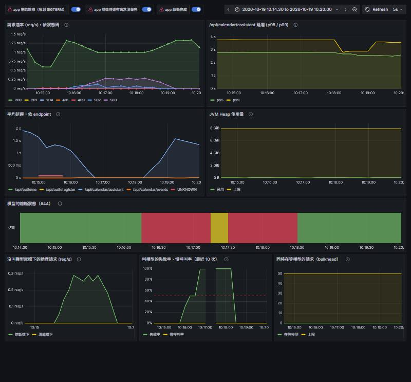
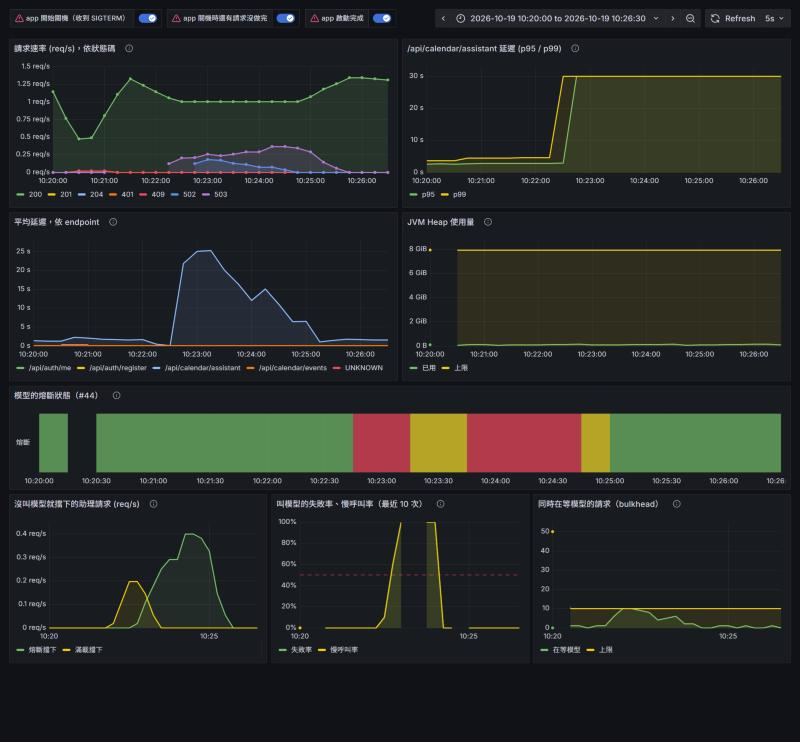

# 模型掛掉演練（#44）：2026-10-19

驗證 circuit breaker + bulkhead（`GuardedChatModel`）在模型**斷線**和**卡住**時的行為，同時確認行程 API 不受影響。
腳本是 [`perf/outage.js`](../../../perf/outage.js)，門檻和理由在 `backend/src/main/resources/application.properties`（演練當時是 `talkcal.model.*`；之後改用 Resilience4j 的 starter，搬到 `resilience4j.*` 的 `chat-model`，值沒變）。

## 環境

不碰共用的 `talkcal-*` 容器，另起一組 `cb44-*`：

| 元件 | 怎麼起 | 用途 |
|---|---|---|
| app | 這個分支 `bootJar`，主機上 `java -jar`，埠 18491 | 被測的 |
| PostgreSQL | `cb44-postgres`（15444） | app 自己的資料庫 |
| 模型那一跳 | `cb44-llm-proxy`：nginx 轉給共用的 `talkcal-llm-chat` | **故障打在這裡**：stop = 斷線、pause = 卡住，真正的模型完全不動 |
| 指標 | `cb44-prometheus` 每 5 秒抓 app，`cb44-grafana` 掛這個分支的 `ops/grafana/provisioning/dashboards` | 截圖用的就是這個 PR 的儀表板 JSON |

兩次都是每分鐘 20 句助理（隨機混合查詢和提議）＋每秒 1 次 `GET /api/calendar/events`。

## 一、斷線（`docker stop`）

60 秒時停掉模型那一跳，兩分鐘後開回來。原始輸出：[stop-k6.txt](stop-k6.txt)、[stop-breaker-log.txt](stop-breaker-log.txt)。

```
    次數      中位數        最久  結果
     51     1339ms     3724ms  200 正常回覆
     11       34ms       65ms  502 ASSISTANT_FAILED（叫了、失敗）
     39       12ms       44ms  503 MODEL_UNAVAILABLE（熔斷，沒叫模型）
      0                        503 MODEL_BUSY（滿載，沒叫模型）
      0                        其他（含沒拿到回應）

行程 API（每秒 1 人）：301 次，失敗 0 次，p95 24ms，最久 30ms
```

- 10:15:46 停掉 → 5 次 502 之後，10:15:59 熔斷打開，之後一律 503 MODEL_UNAVAILABLE、`Retry-After: 30`，中位數 12ms
- 11 次 502 = 打開前 5 次 + 三輪半開各 2 次試探（模型還沒回來，試探失敗又打開）
- 10:17:47 開回來 → 下一輪半開 10:18:17，兩次試探成功，10:18:19 **關回來**，之後都是 200
- 行程 API 301 次全部 200

斷線本來就失敗得很快（連線被拒，34ms），所以這個情境裡熔斷省下的是「明知道會失敗還去叫」，以及讓前端拿到可以辨識的 503。



## 二、卡住（`docker pause`）

60 秒時暫停模型那一跳（連得上、但永遠不回），160 秒後恢復。這一輪把 bulkhead 從 50 **縮成 10**
（`TALKCAL_MODEL_BULKHEAD_MAXCONCURRENTCALLS=10`）：每分鐘 20 句要累積 50 個卡住的請求得等兩分半，
而恢復時一次放出 50 個請求會壓到其他人共用的模型。機制一樣，只是比例縮小。原始輸出：[pause-k6.txt](pause-k6.txt)、[pause-breaker-log.txt](pause-breaker-log.txt)。

```
    次數      中位數        最久  結果
     54     1503ms     5121ms  200 正常回覆
     14    60020ms    60048ms  502 ASSISTANT_FAILED（叫了、失敗）
     41        8ms    57401ms  503 MODEL_UNAVAILABLE（熔斷，沒叫模型）
     11       20ms       49ms  503 MODEL_BUSY（滿載，沒叫模型）
      0                        其他（含沒拿到回應）

行程 API（每秒 1 人）：361 次，失敗 0 次，p95 25ms，最久 70ms
```

- 10:21:23 暫停 → 前 10 個請求卡在模型上；10:21:54 起第 11 個開始，bulkhead 滿了，直接 503 MODEL_BUSY（中位數 20ms），**不再多佔執行緒**
- 10:22:24 起卡住的請求陸續逾時（60 秒，見下面「意外發現」）回 502；第 5 個時 10:22:36 熔斷打開（慢呼叫率 100%），之後 503 MODEL_UNAVAILABLE，4～10ms
- 10:24:04 恢復 → 10:24:42 **關回來**
- 行程 API 361 次全部 200，p95 25ms：模型卡住的整段期間完全沒被拖慢
- MODEL_UNAVAILABLE 有兩個花了 54～57 秒：是半開時放進去試探、剛好被卡住的那幾個，模型恢復後才往下走，下一次叫模型時熔斷又已經打開。半開試探會用到真的使用者請求，這是 circuit breaker 本來的代價



## 意外發現：叫模型實際 60 秒就逾時，不是設定的 2 分鐘

卡住的請求都在 60.0 秒失敗（`AI 助理失敗：Request failed`），但 `spring.ai.openai.chat.timeout=2m`。
這次沒查是 OpenAI SDK 的某個逾時沒吃到這個設定，還是 Docker Desktop 的埠轉發先斷線。跟熔斷無關，另外追
（熔斷的門檻也不依賴它：卡住 60 秒或 120 秒都超過 30 秒的慢呼叫門檻）。

## 反例

| 該擋的有擋 | 正常的沒被誤擋 |
|---|---|
| 斷線：5 次失敗後打開，之後不叫模型 | 兩次演練的前 60 秒（正常）都是 200，熔斷沒有動 |
| 卡住：bulkhead 擋住第 11 個起的請求；熔斷因為慢呼叫打開 | 行程 API 兩次共 662 次全部 200 |
| 模型沒恢復時，半開試探失敗會再打開 | 模型恢復後 30～40 秒內關回來 |

單元測試（`GuardedChatModelTest`）另外蓋到：一直正常不會打開、10 次壞 1 次不會打開、400（請求本身有問題）再多也不會打開、
滿載擋下不算模型失敗。並用兩個突變確認測試會抓：把 bulkhead 和 breaker 的內外順序對調、讓 400 也算失敗，各有一個測試轉紅。
