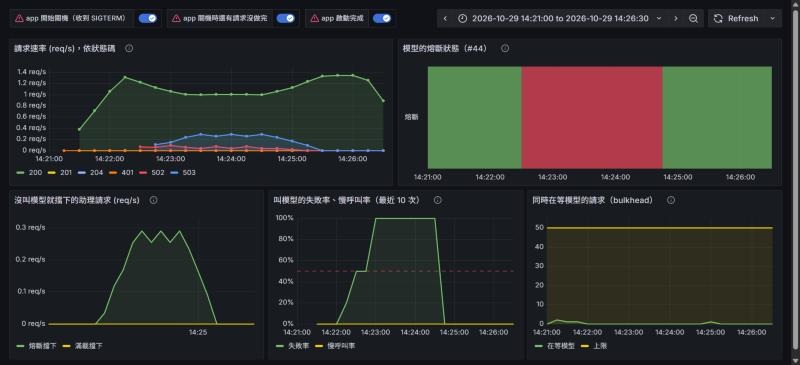
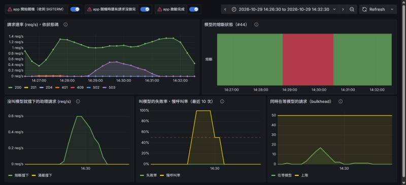
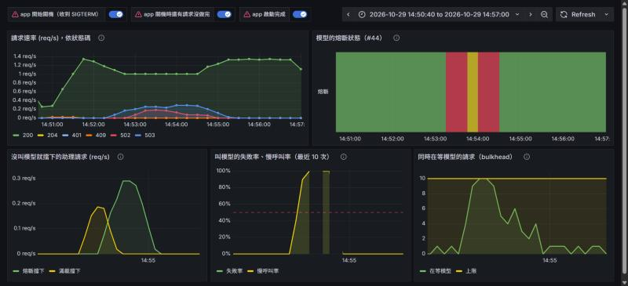

# 用 Toxiproxy 演練：模型斷線、變慢、卡住，加上資料庫斷線的反例（#44）：2026-10-29

驗證兩件事：

1. 斷路器、bulkhead 改用 Resilience4j 的 starter（規則集中在 `application.properties` 的 `resilience4j.*`）之後，實際跑起來跟之前一樣
2. 新的故障注入：`perf/outage.js` 自己透過 Toxiproxy 按時弄壞、恢復，每次同一個時間點

上一輪（10/19，手動 `docker stop`／`pause`）的紀錄在 [2026-10-19-model-outage](../2026-10-19-model-outage/README.md)。

## 環境

沒動共用的 `talkcal-*` 容器，另起一組 `cb44-*`，結構跟 `deploy/compose.chaos.yaml` 一樣：

```
k6 ──> app（這個分支的 jar，主機上跑）──> cb44-toxiproxy ─┬─ llm      ──> 共用的 talkcal-llm-chat（只借用、沒動它）
                                                          └─ postgres ──> cb44-postgres
```

- `cb44-toxiproxy` 用的是 `deploy/toxiproxy.json` 同樣的兩段 proxy，只有上游換成這組環境的位址
- 指標：`cb44-prometheus` 每 5 秒抓 app，`cb44-grafana` 掛這個分支的儀表板 JSON。截圖用一個暫時的儀表板，只放這個 PR 的四個面板加上「請求速率，依狀態碼」，不進 repo
- 每輪都是每分鐘 20 句助理（隨機混合查詢和提議）＋ 每秒 1 次 `GET /api/calendar/events`

## 結果

| 演練 | 指令 | 斷路器 | 被擋下的助理請求 | 恢復後 | 行程 API |
|---|---|---|---|---|---|
| 模型斷線 | `FAULT=down` | 弄壞後 12 秒打開 | 38 次 503，中位數 9ms | 29 秒關回來 | 301 次全 200，p95 16ms |
| 模型變慢（每個回應 +40 秒） | `FAULT=slow` | 慢呼叫率到 100%，弄壞後 52 秒打開 | 45 次 503，中位數 22ms | 33 秒關回來 | 301 次全 200，p95 19ms |
| 模型卡住（bulkhead 縮成 10） | `FAULT=hang` | bulkhead 先擋，卡住的逾時後打開 | 11 次 `MODEL_BUSY`（中位數 8ms）、25 次 `MODEL_UNAVAILABLE`（中位數 9ms） | 恢復當下就關回來 | 361 次全 200，p95 19ms |
| 反例：**資料庫**斷線 | `PROXY=postgres FAULT=down` | **沒動**（只管模型） | 0 | — | 18 次 502（等 30 秒連線逾時），k6 門檻判失敗 |

斷路器每一次狀態改變都記在 [breaker-log.txt](breaker-log.txt)，每一句的結果在各自的 `*-k6.txt`。

### 模型斷線

[down-k6.txt](down-k6.txt)。跟 10/19 手動停容器的結果一致：前 5 次 502（19ms，連線被拒），斷路器打開，之後 503；
11 次 502 = 打開前 5 次 + 三輪半開各 2 次試探。



### 模型變慢（這次才做得到）

[slow-k6.txt](slow-k6.txt)。每個回應晚 40 秒才到 —— 模型沒死、會回，只是超過 30 秒的慢呼叫門檻。
慢呼叫累積到 5 次，慢呼叫率（黃線）到 100%，斷路器打開。這種故障 `docker stop`／`pause` 模擬不出來。

打開那一刻還在跑的回覆，第一步等了 40 秒拿到結果，第二步（呼叫工具後再問模型）才被擋，所以有一些 503 花了 40 秒；
打開後才進來的都是幾十毫秒。全程沒有 502：慢不是失敗，是「太慢」本身讓斷路器打開。



### 模型卡住

[hang-k6.txt](hang-k6.txt)。回應延遲 10 分鐘（比叫模型的逾時還久），對 app 來說就是永遠不回。
bulkhead 用 `-Dresilience4j.bulkhead.instances.chat-model.max-concurrent-calls=10` 縮成 10（理由同 10/19：每分鐘 20 句要累積 50 個卡住的請求太久，而且恢復時一次放出太多請求會壓到共用的模型）。

- 弄壞後前 10 個請求卡在模型上（右下的「在等模型」頂到 10），第 11 個起直接 `MODEL_BUSY`，不再多佔執行緒
- 卡住的請求 60 秒後逾時回 502，第 5 個時斷路器打開，之後 `MODEL_UNAVAILABLE`
- 行程 API 全程沒被拖慢



#### 第一次做「卡住」做錯了

一開始用 Toxiproxy 的 timeout 毒（「資料不轉、連線不關」），app 卻在 5～6 秒就收到 `unexpected end of stream`，等於斷線：

- 加在 downstream（模型 → app）：請求照樣送到，模型回完就關連線，Toxiproxy 把關閉傳回 app
- 加在 upstream（app → 模型）：請求到不了模型，但 llama-server 對閒置 5 秒的連線也會關掉，一樣傳回 app（[hang-upstream-timeout-k6.txt](hang-upstream-timeout-k6.txt)：502 的中位數 5039ms）

timeout 毒擋得住資料、擋不住關連線。改成超長延遲之後，回應和關連線一起被延後，才是真的卡住。腳本和 `deploy/README.md` 都改了。

### 反例：資料庫斷線

[pgdown-k6.txt](pgdown-k6.txt)。弄壞的是 app 到 PostgreSQL 那段：

- 斷路器完全沒動 —— 它只包住叫模型這一條（`breaker-log.txt` 在這段時間沒有任何一行）
- 行程 API 失敗，每次等滿 30 秒（HikariCP 的連線逾時）才回 502；k6 的行程 API 門檻越線，整輪以非 0 結束
- 這正是 PR 討論過的範圍：資料庫的保護是連線池的逾時，不歸斷路器管
