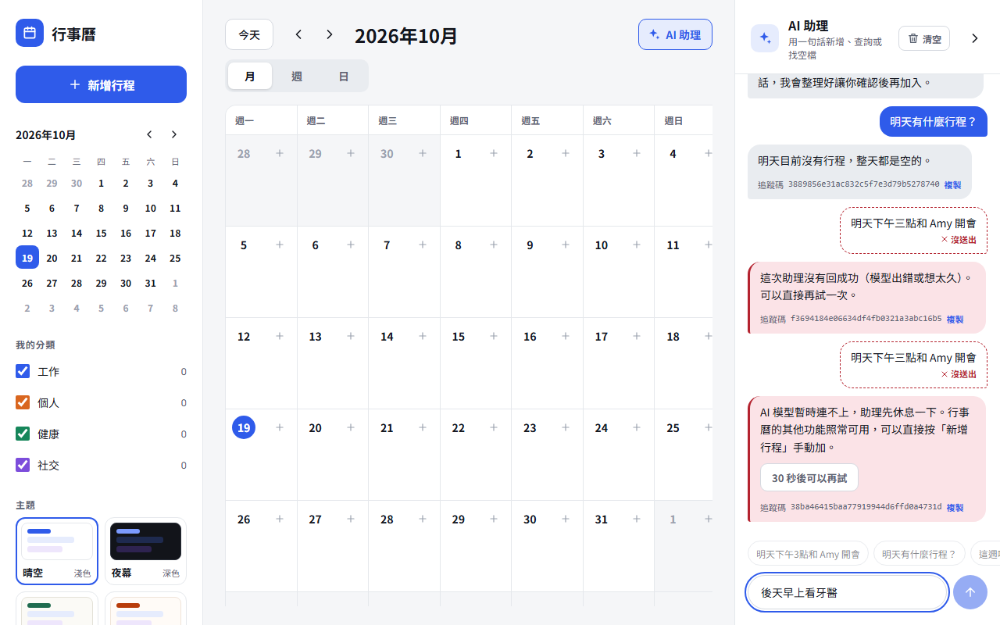
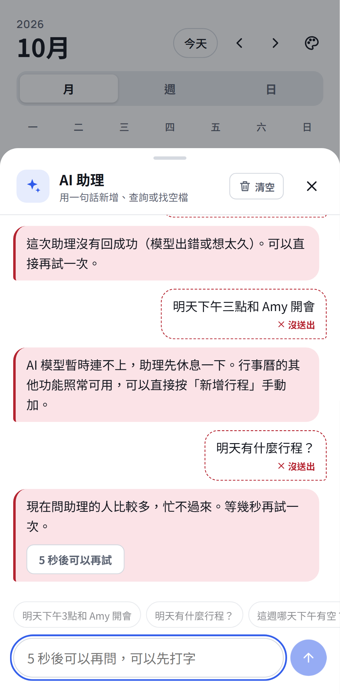

# 失敗時的使用者體驗（#43）：2026-10-19，2026-10-28 重拍

每一種失敗都真的造出來，改之前（`before-*`）和改之後（`after-*`）用同一支腳本、同樣的步驟各截一次，桌面（1280×800）和手機（Pixel 7）都有。
改之前是 master 的前端，改之後是這個分支的前端；後端兩次都是這個分支的（帶著 #44 的熔斷和錯誤格式）。

2026-10-28 重拍：第一次拍的時候分支裡還帶著追蹤碼（#42），之後決定不做、從分支拿掉，截圖跟著重拍，改之前也改成用 master 的前端。
每一種怎麼說、為什麼這樣設計，寫在 [`web/README.md` 的「壞掉的時候畫面怎麼說」](../../../web/README.md)。

## 環境

[`compose.yaml`](compose.yaml) 另起一組 `talkcal43-*`（web 18443、app 18843），沒碰共用的 `talkcal-*`：

```
瀏覽器 → web（nginx.conf＋前端）→ app（#44 的熔斷＋bulkhead，bulkhead 縮成 1）→ llm-proxy（假模型）
```

- **故障都打在容器上**：`docker stop llm-proxy` = 模型斷線、`docker pause llm-proxy` = 模型卡住、`docker stop app` = app 停掉；網路斷是 Playwright 的 `setOffline`；問太快是對 nginx 灌 20 個請求
- **模型是假的**（[`fake-model.conf`](fake-model.conf)，每次回同一句）：要看的是失敗時的畫面，回覆內容不重要；而且演練當時共用的 `talkcal-llm-chat` 是停著的，這組不去開它
- 腳本 [`shoot.mjs`](shoot.mjs)，紀錄 [`before-run.log`](before-run.log)、[`after-run.log`](after-run.log)（每一步打到的 HTTP 狀態）
- 跑完已 `down -v`

## 改之前 → 改之後

| # | 情況 | 後端回 | 改之前 | 改之後 |
|---|---|---|---|---|
| 1 | 正常 | 200 | [桌面](before-1-normal-desktop.png) | [桌面](after-1-normal-desktop.png)／[手機](after-1-normal-mobile.png)：沒有任何失敗的樣子（alert 0 個） |
| 2 | 模型斷線，這次叫了、失敗 | 502 `ASSISTANT_FAILED` | 「助理暫時沒辦法回應：AI 助理失敗：Request failed。可以稍後再試一次。」跟一般回覆長一樣 | [桌面](after-2-model-failed-desktop.png)／[手機](after-2-model-failed-mobile.png)：那句標「沒送出」，紅邊說明＋「再試一次」 |
| 3 | 熔斷打開 | 503 `MODEL_UNAVAILABLE`，30 秒 | 「…請稍後再試；行事曆的其他功能照常可用。可以稍後再試一次。」（「稍後再試」講兩次），沒說要等多久，馬上又能送 | [桌面](after-3-circuit-open-desktop.png)／[手機](after-3-circuit-open-mobile.png)：倒數 30 秒；[倒數中打字](after-3-circuit-open-typing-desktop.png)字留著、送出鈕停用；[倒數完](after-3-circuit-open-countdown-done-desktop.png)變「再試一次」 |
| 4 | 模型卡住，等很久 | 還沒回 | 一直「思考中…」，看不出還活著 | [桌面](after-4-slow-desktop.png)／[手機](after-4-slow-mobile.png)：「還在想，這次比較久（已等 15 秒）…」 |
| 4 | 滿載 | 503 `MODEL_BUSY`，5 秒 | 「AI 助理現在太多人在用…可以稍後再試一次。」 | [桌面](after-4-busy-desktop.png)／[手機](after-4-busy-mobile.png)：倒數 5 秒 |
| 5 | 網路斷了 | 沒有回應 | 「助理暫時沒辦法回應：**Failed to fetch**。」 | [桌面](after-5-offline-desktop.png)／[手機](after-5-offline-mobile.png)：「連不上伺服器，請確認網路連線後再試一次。」不說行事曆照常可用 |
| 6 | app 停掉 | nginx 的 502 HTML | 「助理暫時沒辦法回應：**HTTP 502**。」 | [桌面](after-6-app-down-desktop.png)／[手機](after-6-app-down-mobile.png)：「伺服器暫時沒有回應（HTTP 502），可能正在更新。」 |
| 6 | app 停掉時換月份 | nginx 的 502 HTML | 「讀不到行程：HTTP 502」 | [桌面](after-6-app-down-calendar-desktop.png)：中文原因＋「重新讀取」 |
| 6 | app 停掉時重新整理 | `/api/auth/me` 502 | [約 5 秒空白](before-6-app-down-reload-waiting-desktop.png)，然後是[登入頁](before-6-app-down-reload-desktop.png)：登入著的人以為被登出 | [「正在連線…」](after-6-app-down-reload-waiting-desktop.png)，然後[「暫時連不上伺服器」＋重新連線](after-6-app-down-reload-desktop.png)（[手機](after-6-app-down-reload-mobile.png)） |
| 7 | 問太快 | nginx 的 429，`Retry-After: 60` | 「助理暫時沒辦法回應：問得太快了，請等一分鐘再試。可以稍後再試一次。」，馬上又能送 | [桌面](after-7-rate-limited-desktop.png)／[手機](after-7-rate-limited-mobile.png)：倒數 60 秒 |

改之前的每一張都有對應的 `before-*`（同檔名換前綴）。





## 反例

| 要成立的 | 怎麼證明 | 結果 |
|---|---|---|
| 正常回覆沒有錯誤畫面 | 實測第 1 步數 `role=alert`；E2E「反例：正常回覆沒有任何失敗的樣子」 | 0 個；沒有「沒送出」「再試」 |
| 倒數完之前送不出去 | 實測：倒數中 `送出` 的 disabled = true；E2E 在倒數中按 Enter、第 29 秒時檢查，請求數還是 1 | 成立 |
| 倒數真的有在擋 | 突變：把 `waitSeconds` 改成永遠 0 | E2E 3 個轉紅（連不上、忙碌、問太快），改回全綠 |
| 草稿真的存到同一個人名下 | 一開始的寫法每次現算 key：401 的通知比例外早到，那時 `me` 已經是 null，存到 `anonymous` 去 | E2E「登入過期」抓到（重新登入後輸入框是空的），改成建立時就決定 key 後通過 |
| 真的沒登入還是登入頁 | E2E：`/api/auth/me` 回 401 | 登入頁，不是「連不上」 |
| 「正在連線」不會閃一下 | E2E：0.5 秒時沒有、1.1 秒時才有 | 成立 |
| 舊的失敗不會被插回對話中間 | E2E：失敗後再問一句成功的 | 「再試一次」消失 |
| 不靠 `error` 的字面判斷 | Vitest：同一個 code 換一句話行為不變；502 沒有 code 不當成模型失敗 | 成立 |

跑過的測試：`assistant-failure.desktop.spec.ts`（19）、`assistant-failure.mobile.spec.ts`（1），以及用到同一批檔案的
`assistant-proposals`、`add-event`（桌面、手機）、`login` 的 E2E（共 36）；`assistantFailure.test.ts`、`http.test.ts`（共 17）；`vue-tsc`、ESLint。完整測試照約定由主 session 合併前統一跑。
