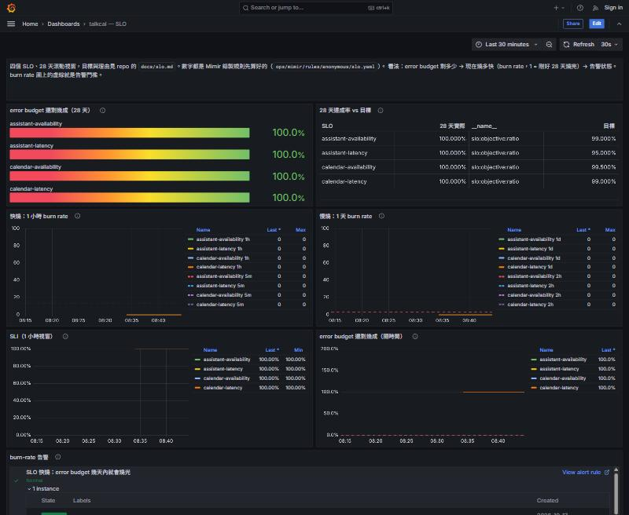
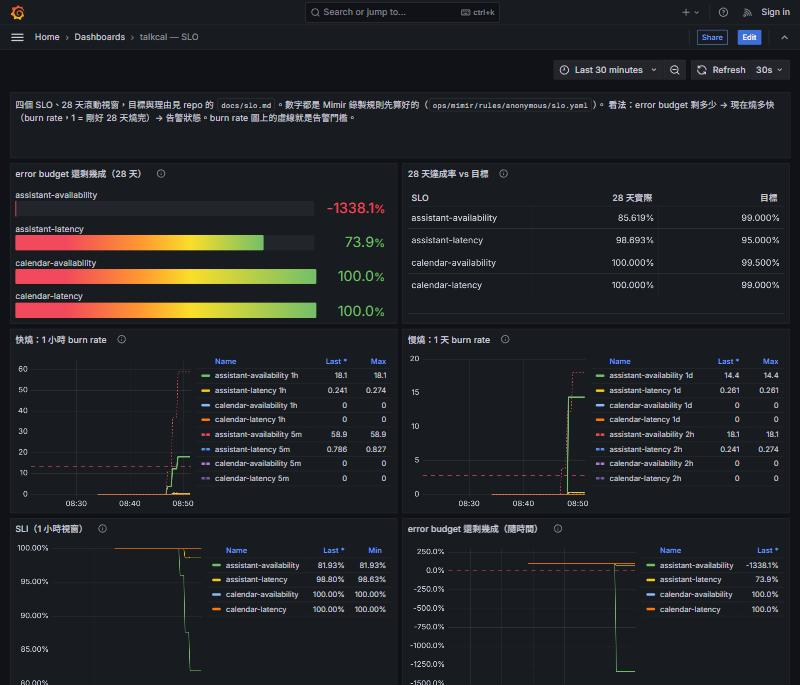
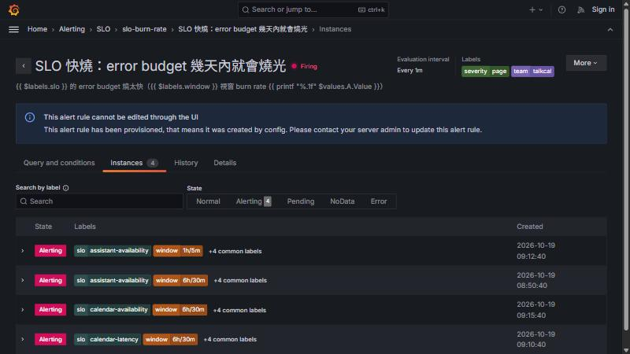

# SLO —— 怎樣才算「夠好」

dashboard 看得到數字，但數字要跟一條線比才知道該不該處理。這份文件定那條線：量什麼（SLI）、目標多少（SLO）、
可以壞多少（error budget）、燒太快時怎麼叫人（burn-rate 告警）。數字都是從 `perf/` 的實測推出來的，推法寫在每一條旁邊。

| 東西 | 在哪 |
|------|------|
| 錄製規則（算 SLI、burn rate、budget） | [ops/mimir/rules/anonymous/slo.yaml](../ops/mimir/rules/anonymous/slo.yaml) |
| 告警規則（burn rate 太高就叫人） | [ops/grafana/provisioning/alerting/slo-burn-rate.yaml](../ops/grafana/provisioning/alerting/slo-burn-rate.yaml) |
| 儀表板 **talkcal — SLO** | [ops/grafana/provisioning/dashboards/talkcal-slo.json](../ops/grafana/provisioning/dashboards/talkcal-slo.json)，<http://localhost:3000/d/talkcal-slo> |
| 延遲門檻的 bucket | [application.properties](../backend/src/main/resources/application.properties) 的 `management.metrics.distribution.slo.http.server.requests` |
| 平常流量／量基準的腳本 | [perf/slo.js](../perf/slo.js) |

## 四個 SLO

全部是**請求數比例**（好的請求 / 全部請求），從 app 自己的 `http_server_requests_seconds` 算；視窗是**滾動 28 天**。

| SLO | 範圍 | 好的請求 | 目標 | error budget（28 天） |
|-----|------|----------|------|------------------------|
| `calendar-availability` | 一般 API：`/api/calendar/events…`、`GET /api/calendar/assistant/{id}` | 不是 5xx | **99.5%** | 0.5% 的請求可以失敗 |
| `calendar-latency` | 同上 | 300ms 內回應 | **99%** | 1% 的請求可以超過 300ms |
| `assistant-availability` | 跟助理說話：`POST /api/calendar/assistant` | 不是 5xx | **99%** | 1% |
| `assistant-latency` | 同上 | 8 秒內回應 | **95%** | 5% 的請求可以超過 8 秒 |

### 為什麼一般 API 和助理分開

助理一個請求是一段 agent loop，要叫模型好幾次（見 [perf/lib/assistant.js](../perf/lib/assistant.js) 開頭），
慢好幾個數量級是**預期**的。放在一起算的話，門檻定 300ms 助理全紅，定 8 秒行程 API 慢 20 倍也看不出來。
可用性也分開：助理多依賴一顆模型，模型塞爆（KV cache 滿）會回 502，一般 API 不該跟著被扣分。

### 數字怎麼來的

2026-10-17 對 docker 那台 app（18090，llm-chat 是 Qwen3-8B、`-np 200`）實測：

| 量什麼 | 怎麼量 | 結果 |
|--------|--------|------|
| 行程 API，平常量 | `perf/slo.js`，每秒 10 個（列表 8 : 新增+刪除 2），90 秒 | p95 13.8ms、p99 26.7ms、max 196ms，0 個 5xx |
| 行程 API，5 倍量 | 同上，每秒 50 個，60 秒 | p95 13.6ms、**p99 152ms**、max 270ms，0 個 5xx |
| 助理，低於臨界值 | `perf/slo.js`，每分鐘 20 句（10 句隨機混合，查詢和提議都有），3 分鐘 | 中位 1.52s、**p95 3.76s**、p99 4.02s，0 個 5xx |
| 助理，同時數一階一階加 | `STEPS=1,2,4,8 HOLD_S=30 perf/knee.js`（每句都是「明天有什麼行程？」） | 見下表 |

| 同時數 | 中位 | p95 | 吞吐量（個/秒） |
|-------:|-----:|----:|----------------:|
| 1 | 783ms | 825ms | 1.30 |
| 2 | 1317ms | 1683ms | 1.47 |
| 4 | 3570ms | 3669ms | 1.20 |
| 8 | 6638ms | **8903ms** | 1.23 |

吞吐量在 2 個人時就到頂（約 1.3～1.5 個/秒），之後再加人只是排隊：這台的臨界值大約是**同時 2 個**。

由此推門檻：

- **一般 API 300ms**：5 倍量時最差的 p99 是 152ms，300ms 約留兩倍空間。正常時碰不到，碰到了就是真的有事（資料庫慢、連線池等不到）。
  比門檻定在 p99 剛好的位置好：那樣平常的抖動就會一直扣 budget。
- **一般 API 99.5% 可用**：實測 0 個 5xx。但只有一台 app、一個資料庫、沒有備援，部署時也會斷一小段（[postmortem](postmortems/2026-10-12-deploy-cuts-in-flight-requests.md)），
  99.9% 意味著 28 天只能壞 0.1%，一次資料庫重啟就用完；99.5% 是單機架構老實做得到的數字。
- **助理 8 秒、95%**：低於臨界值時 p95 3.76s，8 秒約是兩倍。同時 8 個人（臨界值的 4 倍）時 p95 8.9s 就超過了——
  所以這條線剛好落在「正常」和「塞車」中間：平常不會燒，塞車一陣子就燒得到。
  只要 95% 而不是 99%：模型生成長度本來就會變（thinking 有時特別長），p99 會比 p95 抖得多，99% 會常常為了正常的長尾扣 budget。
- **助理 99% 可用**：比一般 API 鬆，因為多了一顆模型，而且 7 天的資料裡壓過容量時有 502（KV cache 滿）。
  能讓使用者重問一次的失敗，比行程存不進去輕微。

### 量了什麼、沒量什麼

- **從 app 量，不是從使用者量。** app 前面還有 nginx（和雲端的 Caddy），nginx 自己回的 502（app 掛了）、429（限流）不會出現在 app 的指標裡。
  app 整個掛掉時這幾個 SLO 反而是「沒資料」而不是「壞」——那種情況要靠 `up == 0` 告警（#121）。
  之後要更貼近使用者，可以改從 nginx 的 access log（Loki）或外部探測算。
- **4xx 不算壞。** 格式錯、沒登入、找不到是呼叫端的問題；但 401 突然暴增也可能是登入壞了，那是產品指標（#36）要看的。
- **延遲算全部請求，包括失敗的。** 失敗得很快的請求會被算成「快」，但它已經在可用性那邊扣過分了。
- **機器平常是關著的**（[AWS 那台](../infra/envs/1-ec2/README.md) 用完就關）。沒請求就沒資料，關機那段時間不算好也不算壞，
  所以「28 天」實際上是「28 天裡有開機的時候」。

## error budget 和 burn rate

- **error budget** = 1 − 目標。99.5% 的 budget 就是「每 200 個請求可以壞 1 個」。用完了代表這 28 天不達標。
  儀表板上的「還剩幾成」= 1 − 28 天的壞事件比例 / budget。
- **burn rate** = 現在的壞事件比例 / budget。1 = 照這速度剛好 28 天用完；10 = 2.8 天用完。
  有了 burn rate，四個目標不同的 SLO 可以用同一組門檻比。

28 天的資料還沒累積滿的時候（例如 Mimir 剛清空），28 天視窗用的是現有的資料，數字會比較跳。

## burn-rate 告警

做法是 Google SRE Workbook 第 5 章〈Alerting on SLOs〉的 **multi-window, multi-burn-rate**——
Grafana 自己的 SLO 功能、Sloth、Pyrra 也都是這套。每個條件都要**長、短兩個視窗**同時超過門檻：
長的證明「燒得夠久、夠多，不是一下下的抖動」；短的（長的 1/12）證明「現在還在燒」，事情一結束短視窗馬上掉下來、告警就解除，
不會等 1 小時的平均慢慢降。

| 告警 | 嚴重度 | 長視窗 | 短視窗 | burn rate 門檻 | 意思 |
|------|--------|--------|--------|----------------|------|
| 快燒 | `critical`（page） | 1h | 5m | 13.44 | 1 小時燒掉 2% 的 budget，照這速度 2 天燒光 |
| 快燒 | `critical`（page） | 6h | 30m | 5.6 | 6 小時燒掉 5%，5 天燒光 |
| 慢燒 | `warning`（ticket） | 1d | 2h | 2.8 | 1 天燒掉 10%，10 天燒光 |
| 慢燒 | `warning`（ticket） | 3d | 6h | 0.933 | 3 天燒掉 10%，這個月會不達標 |

門檻 = 燒掉的比例 × 28 天的小時數（672）/ 長視窗的小時數。Workbook 的表是用 30 天算的（14.4、6、3、1），這裡照 28 天等比換算。

為什麼不用「錯誤率 > 1% 持續 5 分鐘」那種告警：它不知道目標是多少、也不知道已經用掉多少 budget。
目標 99.5% 和 95% 的服務，同一個 1% 的錯誤率一個很嚴重、一個完全沒事；而且 5 分鐘的閃斷每次都會叫人，
就算一整個月加起來根本沒燒到多少 budget。

### 已知的取捨：流量很小時會太敏感

burn rate 是比例。一個小時只有 10 個請求、其中 1 個 502，比例就是 10%，對 99.5% 的目標是 burn rate 20，會 page。
這個作品集平常的流量就是這麼小。Workbook 對低流量的建議是加最低請求數、或合併成比較大的服務一起算；
目前**不加**，理由是：真的有人在用的那段時間，一個 502 就是那位使用者遇到的問題，寧可多看一眼。
等真的被誤報吵到，再在告警條件加「長視窗至少 N 個請求」。

### 通知送去哪

這份只寫規則。contact point（送 email）和 notification policy 是 #121 的範圍，放在同一個資料夾的另一個檔案。
嚴重度用跟它同一套值：快燒 `severity=critical`（Workbook 說的 page）、慢燒 `severity=warning`（ticket），要分流時 policy 比對這個標籤就好。在那之前，規則照樣評估、狀態在 Grafana 的 **Alerting → Alert rules** 和 SLO 儀表板最下面看得到。

## 驗證：故障讓告警響、正常時不響

在獨立的一組容器裡做（自己的 app、postgres、mimir、alloy、grafana，compose 專案 `talkcal-34-verify`），
`perf/slo.js` 一直送平常流量（每秒 5 個行程請求、每分鐘 6 句助理），再一次弄壞一種依賴：

2026-10-19 實測（時間是 UTC）：

| 時段 | 做了什麼 | 結果 |
|------|----------|------|
| 00:33–00:45 | 只有平常流量 | 四個 SLO 的 burn rate（5m、1h、1d）都是 0，budget 100%，兩條告警都是 Normal。**正常流量不觸發** |
| 00:45 | **模型斷線**：把 app 從 deploy/ 的網路拔掉，找不到 llm-chat，助理一律 502 | 00:50 快燒 `assistant-availability` 進 firing（約 5 分鐘）；`calendar-*` 的 burn rate 維持 0，**行程 API 沒被誤判** |
| 00:51 | 接回網路 | 5m 的 burn rate 回到 0，1h 還有 23.7，`1h/5m` 那組在 01:00 解除：**事情結束，短視窗讓告警跟著停**，不必等 1 小時的平均降下來 |
| 01:01–01:08 | **資料庫斷續卡住**：每 5 秒 `docker pause` postgres 2 秒 | 約三成行程請求超過 300ms（5m burn 28.8、1h 4.3）：只有慢燒 `calendar-latency` 進 firing，**沒到快燒門檻**；`calendar-availability` 維持 0（慢但沒失敗） |
| 01:08–01:16 | **資料庫停掉**：`docker stop` postgres | 行程 API 全部 502（5m burn 200 = 100% 失敗），01:15 快燒 `calendar-availability` 進 firing；助理也要讀資料庫，`assistant-availability` 跟著燒 |
| 01:16–01:50 | 重新啟動 postgres，只剩平常流量 | 01:50 快燒全部解除：5m、30m 的 burn rate 都回到 0，但 1h（`calendar-availability` 8.3）、6h（6.5）還很高——**故障結束後告警不會因為長視窗還沒降下來就一直響** |

讀這組結果要注意：驗證用的 Mimir 只有不到 1 小時的資料，所以 6h、1d、3d、28d 視窗看到的其實都是這 1 小時——

- 快燒先從 `6h/30m` 那組響（門檻 5.6 比 13.44 低），真實環境 6 小時視窗裡有更多正常流量，會是 `1h/5m` 先響。
- 慢燒（`1d/2h`、`3d/6h`）跟著一起響、budget 掉到 −1338%：一天裡只有這一小時的資料，等於把這一小時當成一整天。
  上線跑滿 28 天之後，同樣 6 分鐘的模型斷線（流量平均時）大約燒掉 budget 的 1.5%（6 分鐘 ÷ 40,320 分鐘 × 100% 失敗 ÷ 1% budget），不會觸發慢燒。

這組容器（`talkcal-34-*`）只在驗證時起，跟共用的 deploy/、ops/ 分開，故障不會影響別人；驗完就刪掉了。

## 怎麼改目標

1. 改 `ops/mimir/rules/anonymous/slo.yaml` 的 `slo:objective:ratio`（目標），或第一層 `slo:sli_bad_events:rate5m` 裡延遲門檻的 `le`（範圍和門檻只寫在第一層，各視窗都從那裡推算）。
2. 改延遲門檻時，`application.properties` 的 `management.metrics.distribution.slo.http.server.requests` 也要有那個值，不然沒有那個 bucket。
3. 重啟 mimir（`docker compose restart mimir`）；改了 app 的設定要重新部署 app。
4. 這份文件的表和理由一起改。
