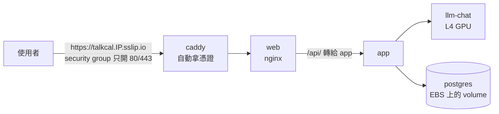
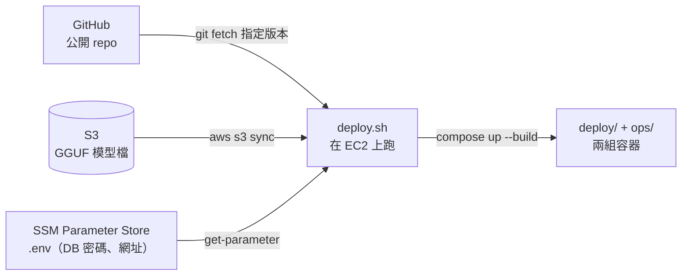

# 1-ec2 — 階段一：單台 EC2 + Docker Compose

狀態：**IaC 寫好了，還沒 apply 過**。追蹤在 [#57](https://github.com/Anderson-chen/talkcal/issues/57)；整體的階段怎麼分見 [infra/README.md](../../README.md)。
下面的步驟和指令都還沒在真的 AWS 帳號上跑過；第一次 apply 時遇到的問題補進「疑難排解」。

一台有 GPU 的 EC2，`deploy/` 和 `ops/` 兩組 compose 原樣搬上去，前面加一個 Caddy 處理 HTTPS。

## 1. 使用者的請求怎麼走



從 web 往後跟本機完全一樣。差別只在入口多了 Caddy。

## 2. 程式、模型、密碼怎麼上機器



觀測那組跟本機一模一樣。看 Grafana 用 SSM 的 port forwarding 接回本機，不對外開 3000。

## 檔案

| 檔案 | 做什麼 |
|---|---|
| `backend.tf`、`backend.hcl.example` | state 放 bootstrap 建的 S3 bucket；bucket 名稱帶帳號 ID，放在 gitignore 掉的 `backend.hcl` |
| `vpc.tf` | 一個公有子網，不建 NAT；可用區自動挑有這個 GPU 機型的 |
| `security-groups.tf` | 只開 80/443（含 HTTP/3 的 UDP 443）；22 預設關 |
| `ec2.tf` | Deep Learning Base AMI（Ubuntu 24.04）、g6.xlarge、Elastic IP、強制 IMDSv2 |
| `iam.tf` | 機器的角色：SSM 連線、讀模型 bucket、讀 `.env` 參數，別的都碰不到 |
| `s3.tf` | 模型檔的 bucket |
| `secrets.tf` | 產生 DB 密碼，連同網址寫成一份 `.env` 存進 SSM |
| `user-data.sh.tftpl` | 第一次開機：驗證 GPU 和 Docker、補 compose/buildx、clone、第一次部署 |
| `deploy.sh` | 在機器上跑的部署：拉版本 → 拉模型 → 拉 `.env` → 兩組 compose up |
| `compose.ec2.yaml` | 疊在 `deploy/compose.yaml` 上的雲端差異：模型來源、DB 密碼、app 記憶體上限、Caddy |
| `Caddyfile` | HTTPS 入口，全部轉給 web |

## 跟本機比，改了什麼

| 項目 | 本機 | EC2 上 | 在哪裡改 |
|---|---|---|---|
| GPU | RTX（Ada） | g6.xlarge 的 L4（也是 Ada，sm_89）。llama-server 映像檔編的是 `CUDA_ARCH=89`，同一份直接跑；g4dn 的 T4 是 sm_75，要重編 | `variables.tf` |
| 驅動 | Docker Desktop 處理 | Deep Learning Base AMI 裝好了；開機時印 `nvidia-smi`，CUDA 13 要驅動 580 以上 | `ec2.tf`、`user-data.sh.tftpl` |
| 模型檔 | `C:/llm/models` | S3 → `/opt/talkcal/models` → model-seed 照舊驗 SHA256、複製進 volume | `s3.tf`、`deploy.sh`、`compose.ec2.yaml` |
| HTTPS | 沒有 | Caddy + sslip.io：用 IP 推出網域，不必買網域也有 Let's Encrypt 憑證 | `compose.ec2.yaml`、`Caddyfile` |
| 對外的埠 | 全部綁 `127.0.0.1` | 只有 Caddy 開 80/443；Grafana、Loki 原本沒綁位址，已改成 `127.0.0.1`（本機也一起改了） | `ops/compose.yaml`、`security-groups.tf` |
| 登入機器 | 本機 | SSM Session Manager，不開 22 | `iam.tf` |
| DB 密碼 | 寫死 `talkcal` | Terraform 隨機產生 → SSM → `deploy/.env`（[#14](https://github.com/Anderson-chen/talkcal/issues/14) 在雲端上解掉了，本機還是寫死） | `secrets.tf`、`compose.ec2.yaml` |
| app 記憶體 | 沒上限 | `mem_limit: 2g`：沒設的話 JVM 的 75% 是算整台 16GB | `compose.ec2.yaml` |
| 映像檔 | 本機 build | 在 EC2 上 build；做[版本 tag](https://github.com/Anderson-chen/talkcal/issues/25) 時再改成 CI 推到 ECR | `deploy.sh` |

## 首次部署

前提：AWS CLI 的 `DEV` profile 登入得了；**GPU 配額已經申請下來**（「Running On-Demand G and VT instances」預設是 0，2026-10-13 查過東京也是 0；g6.xlarge 要 4 vCPU）。

在 Git Bash 裡跑 AWS CLI 時，參數裡以 `/` 開頭的字串（例如 SSM 參數名稱 `/aws/service/...`）會被轉成 Windows 路徑，回 `ParameterNotFound`。前面加 `MSYS_NO_PATHCONV=1` 就好。

```bash
# 0. 共用的 state bucket 和花費告警（整個帳號只跑一次）
cd infra/bootstrap
terraform init
terraform apply -var="alert_email=<你的信箱>"

# 1. 基礎設施
cd ../envs/1-ec2
cp backend.hcl.example backend.hcl        # 填入上一步輸出的 state_bucket
terraform init -backend-config=backend.hcl
terraform apply

# 2. 上傳模型檔（只要一次；SHA256SUMS 一起傳，model-seed 會驗）
aws s3 cp C:/llm/models/Qwen3-8B-Q4_K_M.gguf "s3://$(terraform output -raw models_bucket)/" --profile DEV
aws s3 cp C:/llm/models/SHA256SUMS            "s3://$(terraform output -raw models_bucket)/" --profile DEV
```

機器開機後 user_data 會自動跑第一次部署。如果模型檔是在機器開機**之後**才傳上去，第一次部署會停在「S3 裡沒有 .gguf」，傳好之後手動重跑一次：

```bash
aws ssm start-session --target "$(terraform output -raw instance_id)" --region ap-northeast-1 --profile DEV
sudo bash /opt/talkcal/repo/infra/envs/1-ec2/deploy.sh
```

第一次要編 llama-server（CUDA，十幾分鐘）、build app、拉映像檔，會跑很久，進度看 `sudo tail -f /var/log/user-data.log`。
好了之後開 `terraform output -raw app_url`。

## 日常操作

```bash
# 部署新版：master 合併之後，到機器上重跑
sudo bash /opt/talkcal/repo/infra/envs/1-ec2/deploy.sh
# 先部署某個分支試試
sudo GIT_REF=57-ec2 bash /opt/talkcal/repo/infra/envs/1-ec2/deploy.sh

# 看狀態
cd /opt/talkcal/repo
sudo docker compose -f deploy/compose.yaml -f infra/envs/1-ec2/compose.ec2.yaml ps
sudo docker stats --no-stream && free -h && nvidia-smi

# 看 Grafana：在本機跑這行，再開 http://localhost:3000
terraform output -raw grafana_tunnel
```

## 省錢

GPU 機器按小時計費，平常關機、展示時才開。關機時還在收費的只有 EBS（150GB gp3）和沒掛在執行中機器上的 Elastic IP。

```bash
aws ec2 stop-instances  --instance-ids "$(terraform output -raw instance_id)" --region ap-northeast-1 --profile DEV
aws ec2 start-instances --instance-ids "$(terraform output -raw instance_id)" --region ap-northeast-1 --profile DEV
```

容器都設了 `restart: unless-stopped`，開機後會自己起來，不必重跑 deploy.sh；但模型要重新載入，第一個請求會等比較久。
徹底收攤用 `terraform destroy`：IP 釋出、網址跟著換，資料庫資料也會一起消失。

## 代價

- 只有一台：機器掛了服務就停，部署時那十幾秒沒人接也還在。
- rolling update、canary 在單機上做不太出來，這些留給[階段二](../2-eks/README.md)。
- 機器上 build 映像檔：第一次很慢，而且線上跑的映像檔沒有版本號，退版要重新 build 舊的 commit。

## 已經決定的

| 問題 | 選擇 | 理由 |
|---|---|---|
| 機型 | g6.xlarge | 映像檔是 sm_89，L4 不用重編；T4 便宜但要另外編一份 |
| HTTPS | Caddy + sslip.io | 一個設定檔包辦憑證和續期，不必買網域；跟 cool-down 同一套做法 |
| 觀測放哪 | 同一台，跟本機同一份 `ops/` | 最能證明「搬得動」；記憶體不夠再考慮 Grafana Cloud |
| 映像檔從哪來 | 機器上 build | 不必先從家裡推幾 GB 的 CUDA 映像檔上 ECR；版本 tag 做了再改 |
| Region | 東京 ap-northeast-1 | 2026-10-13 查過：台北 ap-east-2 沒有任何 G 系列機型（g4dn、g5、g6 都沒有）；東京的 g6.xlarge 在 1a、1c 兩個可用區 |

## 待決定

| 問題 | 選項 | 目前傾向 |
|---|---|---|
| 開機策略 | 常駐 / 平常關機、展示才開 | 平常關機 |
| EBS 自動快照 | 現在沒有 / Data Lifecycle Manager 每天一次 | 跟 [#45 備份與還原](https://github.com/Anderson-chen/talkcal/issues/45) 一起做 |

## 疑難排解

還沒實際跑過，先列預期會遇到的：

| 症狀 | 檢查 |
|---|---|
| `terraform apply` 開不出機器，說 vCPU 上限 | GPU 配額還沒申請或還沒核准（Service Quotas → EC2 → Running On-Demand G and VT instances） |
| user_data 沒跑完 | `sudo cat /var/log/user-data.log`。`nvidia-smi` 失敗是 AMI 驅動的問題；`docker compose` 失敗看 compose / buildx 有沒有裝上 |
| llm-chat 起不來，log 說 CUDA 版本 | 驅動太舊，CUDA 13 要 580 以上：`nvidia-smi` 右上角的 CUDA Version |
| 憑證拿不到 | security group 的 80 要對 0.0.0.0/0 開（Let's Encrypt 的 HTTP-01 驗證走這裡）；`docker logs talkcal-caddy` |
| 容器被 OOM kill | `docker inspect <名稱> --format '{{.State.OOMKilled}}'`；先調 `mem_limit`，再考慮換 g6.2xlarge |
