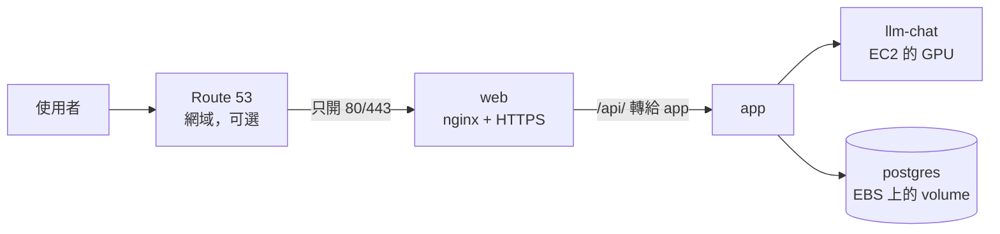
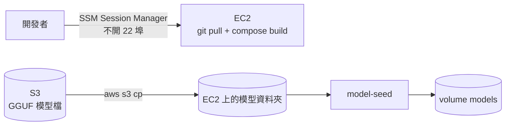

# 1-ec2 — 階段一：單台 EC2 + Docker Compose

狀態：**規劃中**，追蹤在 [#57](https://github.com/Anderson-chen/talkcal/issues/57)。整體的階段怎麼分見 [infra/README.md](../../README.md)。

一台有 GPU 的 EC2，裝好 Docker，`deploy/` 和 `ops/` 兩組 compose 原樣搬上去。

## 1. 使用者的請求怎麼走

整條路跟本機一樣，全部在同一台機器的 Docker 網路裡。差別只在入口：security group 只放 80/443 進來。

## 2. 程式、模型怎麼上機器

觀測那組跟本機一模一樣，不另外畫。看 Grafana 用 SSM 的 port forwarding，不對外開 3000。

## 跟本機比，要改的地方

| 項目 | 本機 | EC2 上 |
|---|---|---|
| 機型 | RTX 12GB | GPU 機型：g4dn（T4 16GB）最便宜，Qwen3-8B Q4 放得下；g6（L4 24GB）較新較快 |
| GPU 配額 | 不用 | 新帳號 G 系列的配額預設是 0，要先到 Service Quotas 申請，審核可能要等 |
| 驅動 | Docker Desktop 處理 | 用 AWS 的 Deep Learning Base AMI（NVIDIA 驅動、Docker、container toolkit 都裝好）。llama-server 映像檔是 CUDA 13，開機後 `nvidia-smi` 確認驅動夠新 |
| 模型檔 | `C:/llm/models` | 放 S3，開機時拉到 EC2 上的資料夾，model-seed 的來源改指那裡 |
| 對外的埠 | 全部綁 `127.0.0.1` | 只有 web 開 80/443。**ops/ 的 Grafana 3000、Loki 3100 現在沒綁位址，要先改成 `127.0.0.1`** |
| HTTPS | 沒有 | nginx 加憑證（certbot），或前面加 Caddy 自動拿；要有網域 |
| 登入機器 | 本機 | SSM Session Manager，security group 不開 22 |
| DB 密碼 | 寫在 compose | 放 SSM Parameter Store，部署時寫成 `.env`，不進版控（[#14](https://github.com/Anderson-chen/talkcal/issues/14)） |
| 映像檔 | 本機 build | 先在 EC2 上 build；做 [版本 tag](https://github.com/Anderson-chen/talkcal/issues/25) 時再改成 CI 推到 ECR |
| 資料庫備份 | volume | EBS 快照排程（Data Lifecycle Manager），[#45](https://github.com/Anderson-chen/talkcal/issues/45) 有地方演練 |
| 記憶體 | 主機很大 | xlarge 只有 16GB，要塞 JVM、Postgres 和整組觀測，有點緊；不夠就換 2xlarge |
| 費用 | 0 | GPU 按小時計費。平常關機、展示時才開，關機時只付 EBS（[#35](https://github.com/Anderson-chen/talkcal/issues/35)） |

## 代價

- 只有一台：機器掛了服務就停，部署時那十幾秒沒人接也還在。
- rolling update、canary 在單機上做不太出來，這些留給階段二。

## 待決定（階段一）

| 問題 | 選項 | 目前傾向 |
|---|---|---|
| 機型 | g4dn.xlarge / g6.xlarge / 2xlarge | 先 g4dn 跑通，記憶體或速度不夠再換；以 AWS 定價頁和實測為準 |
| Region | 東京 ap-northeast-1 / 台北 ap-east-2 | 要先確認該區有沒有這些 GPU 機型和配額 |
| HTTPS 怎麼做 | nginx + certbot / Caddy / 前面加 CloudFront | Caddy 最省事；CloudFront 順便有快取和 WAF，但多一層 |
| 開機策略 | 常駐 / 平常關機、展示才開 | 平常關機，第一個請求要等開機和載模型 |
| 觀測放哪 | 同一台 / Grafana Cloud 免費額度 | 同一台，跟本機同一套；記憶體不夠再搬 |

## 做完時這份 README 要補上的

照 cool-down 的 `infra/envs/ec2/README.md` 的段落，做 [#57](https://github.com/Anderson-chen/talkcal/issues/57) 時補：

- 首次部署：`terraform apply` → build 映像檔 → 到機器上跑部署腳本，一步一步的指令
- 日常操作：改了 compose 怎麼推、換映像檔怎麼推、怎麼看狀態和 log
- 記憶體預算：每個容器的 `mem_limit` 和實測用量
- 省錢：開關機指令、關機時還在計費的項目
- 疑難排解：症狀 → 檢查什麼
