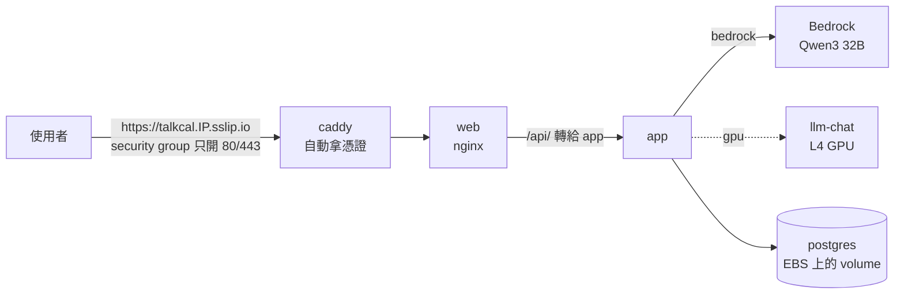
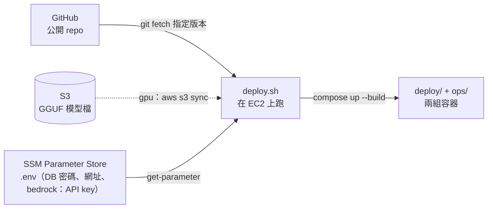

# 1-ec2 — 階段一：單台 EC2 + Docker Compose

狀態：**2026-10-14 部署上線**（`model_backend=bedrock`），從外部經 HTTPS 打 AI 助理、Grafana 看到三種訊號都驗證過。
機器平常關機，展示前開機。追蹤在 [#57](https://github.com/Anderson-chen/talkcal/issues/57)；整體的階段怎麼分見 [infra/README.md](../../README.md)。
第一次部署遇到的三個問題寫在「疑難排解」最前面。

一台 EC2，`deploy/` 和 `ops/` 兩組 compose 搬上去，前面加一個 Caddy 處理 HTTPS。
模型在哪裡跑由變數 `model_backend` 決定，其他（VPC、Caddy、DB、觀測）兩種共用：

| `model_backend` | 機器 | 模型 | 現況 |
|---|---|---|---|
| `bedrock`（預設） | m7i-flex.large，Ubuntu 24.04 | app 呼叫 Bedrock 的 Qwen3 32B（OpenAI 相容 API） | 現在就能部署 |
| `gpu` | g6.xlarge，Deep Learning AMI | 跟本機一樣自己跑 llama-server（Qwen3-8B），模型從 S3 拉 | 等 GPU 配額 |

## 為什麼先走 Bedrock

2026-10-13 申請東京區 G 系列配額（新帳號預設 0）被拒，AWS 要新帳號「逐步增加用量」。一般機型的配額已經有 32 vCPU，
Bedrock 也不受 EC2 GPU 配額限制，所以先把模型換成代管的 API：

- **程式不用改**：app 用 Spring AI 的 OpenAI client，本機打 llama-server、雲端打 Bedrock 的 `bedrock-mantle` 端點，
  只換位址、key、模型名稱（`compose.bedrock.yaml` 用環境變數蓋掉）。
  2026-10-13 在東京實測過 mantle 上 Qwen3 32B 的 `json_schema` 輸出（抽行程用）和工具呼叫（AI 助理用）都能動。
- **便宜**：m7i-flex.large 約 0.1 USD/h（符合免費方案資格），g6.xlarge 約 0.8–1 USD/h；展示用的量，token 費用很少。
- **代價**：雲端跟本機跑的不是同一顆模型（32B vs 8B），少了「同一份 compose 原樣搬上去」；
  多了一把要保管的 API key（見 `bedrock.tf`）。

GPU 配額下來後：`terraform apply -var model_backend=gpu`，再照下面「首次部署」的 gpu 步驟傳模型。
之後想拿掉那把 key，改用 Spring AI 的 Bedrock Converse 模組直接吃 EC2 的角色。

## 1. 使用者的請求怎麼走



從 web 往後跟本機一樣，差在入口多了 Caddy、模型依 `model_backend` 換地方。

## 2. 程式、模型、密碼怎麼上機器



觀測那組跟本機一模一樣。看 Grafana 用 SSM 的 port forwarding 接回本機，不對外開 3000。

## 檔案

| 檔案 | 做什麼 |
|---|---|
| `backend.tf`、`backend.hcl.example` | state 放 bootstrap 建的 S3 bucket；bucket 名稱帶帳號 ID，放在 gitignore 掉的 `backend.hcl` |
| `variables.tf` | `model_backend` 和依它決定預設值的機型、磁碟 |
| `vpc.tf` | 一個公有子網，不建 NAT；可用區自動挑有這個機型的 |
| `security-groups.tf` | 只開 80/443（含 HTTP/3 的 UDP 443）；22 預設關 |
| `ec2.tf` | AMI（bedrock：Ubuntu 24.04；gpu：Deep Learning Base AMI）、機型、Elastic IP、強制 IMDSv2 |
| `iam.tf` | 機器的角色：SSM 連線、讀 `.env` 參數，gpu 再加讀模型 bucket，別的都碰不到 |
| `bedrock.tf` | （bedrock）只能呼叫模型的專用 IAM user，和它的 Bedrock API key（90 天過期） |
| `s3.tf` | （gpu）模型檔的 bucket |
| `secrets.tf` | 產生 DB 密碼，連同網址（和 Bedrock 的位址、key、模型）寫成一份 `.env` 存進 SSM |
| `user-data.sh.tftpl` | 第一次開機：裝或驗證 Docker（gpu 再驗 GPU）、補 compose/buildx、clone、第一次部署 |
| `deploy.sh` | 在機器上跑的部署：拉版本 →（gpu）拉模型 → 拉 `.env` → 兩組 compose up |
| `compose.ec2.yaml` | 疊在 `deploy/compose.yaml` 上、兩種共用的雲端差異：DB 密碼、app 記憶體上限、Caddy |
| `compose.bedrock.yaml` | 不起 `llm-chat`、`model-seed`；app 的模型位址、key、名稱換成 Bedrock 的 |
| `compose.gpu.yaml` | 模型來源換成從 S3 拉下來的資料夾 |
| `Caddyfile` | HTTPS 入口，全部轉給 web |

## 跟本機比，改了什麼

| 項目 | 本機 | EC2 上 | 在哪裡改 |
|---|---|---|---|
| 模型 | 本機 GPU 跑 llama-server（Qwen3-8B） | bedrock：Bedrock 的 Qwen3 32B；gpu：g6.xlarge 的 L4 跑同一份 llama-server（也是 Ada，sm_89，映像檔編的是 `CUDA_ARCH=89`；g4dn 的 T4 是 sm_75，要重編） | `variables.tf`、`compose.bedrock.yaml` |
| 驅動 | Docker Desktop 處理 | gpu：Deep Learning Base AMI 裝好了，開機時印 `nvidia-smi`，CUDA 13 要驅動 580 以上 | `ec2.tf`、`user-data.sh.tftpl` |
| 模型檔 | `C:/llm/models` | gpu：S3 → `/opt/talkcal/models` → model-seed 照舊驗 SHA256、複製進 volume；bedrock：沒有 | `s3.tf`、`deploy.sh`、`compose.gpu.yaml` |
| HTTPS | 沒有 | Caddy + sslip.io：用 IP 推出網域，不必買網域也有 Let's Encrypt 憑證 | `compose.ec2.yaml`、`Caddyfile` |
| 對外的埠 | 全部綁 `127.0.0.1` | 只有 Caddy 開 80/443；Grafana、Loki 原本沒綁位址，已改成 `127.0.0.1`（本機也一起改了） | `ops/compose.yaml`、`security-groups.tf` |
| 登入機器 | 本機 | SSM Session Manager，不開 22 | `iam.tf` |
| DB 密碼 | 寫死 `talkcal` | Terraform 隨機產生 → SSM → `deploy/.env`（[#14](https://github.com/Anderson-chen/talkcal/issues/14) 在雲端上解掉了，本機還是寫死） | `secrets.tf`、`compose.ec2.yaml` |
| app 記憶體 | 沒上限 | `mem_limit: 2g`：沒設的話 JVM 的 75% 是算整台（8GB 或 16GB） | `compose.ec2.yaml` |
| 映像檔 | 本機 build | 在 EC2 上 build；做[版本 tag](https://github.com/Anderson-chen/talkcal/issues/25) 時再改成 CI 推到 ECR | `deploy.sh` |

## 首次部署

前提：AWS CLI 的 `DEV` profile 登入得了。`gpu` 還要 **GPU 配額已經申請下來**（「Running On-Demand G and VT instances」預設是 0，2026-10-13 申請被拒；g6.xlarge 要 4 vCPU）。

在 Git Bash 裡跑 AWS CLI 時，參數裡以 `/` 開頭的字串（例如 SSM 參數名稱 `/aws/service/...`）會被轉成 Windows 路徑，回 `ParameterNotFound`。前面加 `MSYS_NO_PATHCONV=1` 就好。

```bash
# 0. 共用的 state bucket 和花費告警（整個帳號只跑一次）
cd infra/bootstrap
terraform init
terraform apply -var="alert_email=<你的信箱>"

# 1. 基礎設施（預設 bedrock；GPU 配額下來後加 -var model_backend=gpu）
cd ../envs/1-ec2
cp backend.hcl.example backend.hcl        # 填入上一步輸出的 state_bucket
terraform init -backend-config=backend.hcl
terraform apply

# 2.（只有 gpu）上傳模型檔（只要一次；SHA256SUMS 一起傳，model-seed 會驗）
aws s3 cp C:/llm/models/Qwen3-8B-Q4_K_M.gguf "s3://$(terraform output -raw models_bucket)/" --profile DEV
aws s3 cp C:/llm/models/SHA256SUMS            "s3://$(terraform output -raw models_bucket)/" --profile DEV
```

機器開機後 user_data 會自動跑第一次部署。gpu 時如果模型檔是在機器開機**之後**才傳上去，第一次部署會停在「S3 裡沒有 .gguf」，傳好之後手動重跑一次：

```bash
aws ssm start-session --target "$(terraform output -raw instance_id)" --region ap-northeast-1 --profile DEV
sudo bash /opt/talkcal/repo/infra/envs/1-ec2/deploy.sh
```

第一次要裝 Docker、build app、拉映像檔，會跑一陣子（gpu 還要編 llama-server 的 CUDA，十幾分鐘），進度看 `sudo tail -f /var/log/user-data.log`。
好了之後開 `terraform output -raw app_url`。

## 日常操作

```bash
# 部署新版：master 合併之後，到機器上重跑
sudo bash /opt/talkcal/repo/infra/envs/1-ec2/deploy.sh
# 先部署某個分支試試
sudo GIT_REF=57-ec2 bash /opt/talkcal/repo/infra/envs/1-ec2/deploy.sh

# 看狀態
cd /opt/talkcal/repo
sudo docker compose -f deploy/compose.yaml -f infra/envs/1-ec2/compose.ec2.yaml -f infra/envs/1-ec2/compose.bedrock.yaml ps
sudo docker stats --no-stream && free -h       # gpu 再加 nvidia-smi

# Bedrock API key 到期前換新（預設 90 天），再到機器上重跑 deploy.sh
terraform apply -replace='aws_iam_service_specific_credential.bedrock[0]'
# 換 DB 密碼（例如懷疑外洩），再到機器上重跑 deploy.sh：它會把資料庫裡的密碼同步成新的那組
terraform apply -replace=random_password.db

# 看 Grafana：在本機跑這行，再開 http://localhost:3000
terraform output -raw grafana_tunnel
```

## 省錢

機器按小時計費（bedrock 的 m7i-flex.large 約 0.1 USD/h，gpu 的 g6.xlarge 約 0.8–1 USD/h），平常關機、展示時才開。
關機時還在收費的只有 EBS（bedrock 30GB、gpu 150GB 的 gp3）和沒掛在執行中機器上的 Elastic IP。Bedrock 按 token 計費，不叫就不收。

```bash
aws ec2 stop-instances  --instance-ids "$(terraform output -raw instance_id)" --region ap-northeast-1 --profile DEV
aws ec2 start-instances --instance-ids "$(terraform output -raw instance_id)" --region ap-northeast-1 --profile DEV
```

容器都設了 `restart: unless-stopped`，開機後會自己起來，不必重跑 deploy.sh；gpu 時模型要重新載入，第一個請求會等比較久。
徹底收攤用 `terraform destroy`：IP 釋出、網址跟著換，資料庫資料也會一起消失。

## 代價

- 只有一台：機器掛了服務就停，部署時那十幾秒沒人接也還在。
- rolling update、canary 在單機上做不太出來，這些留給[階段二](../2-eks/README.md)。
- 機器上 build 映像檔：第一次很慢，而且線上跑的映像檔沒有版本號，退版要重新 build 舊的 commit。

## 已經決定的

| 問題 | 選擇 | 理由 |
|---|---|---|
| 模型在哪跑 | 先走 Bedrock，`model_backend` 留著切回 gpu | GPU 配額被拒；理由見上面「為什麼先走 Bedrock」 |
| 機型（bedrock） | m7i-flex.large | 8GB 放得下 app、Postgres、Caddy、整組觀測；t3.small（2GB）、c7i-flex.large（4GB）不夠 |
| 機型（gpu） | g6.xlarge | 映像檔是 sm_89，L4 不用重編；T4 便宜但要另外編一份 |
| Bedrock 怎麼驗證身分 | 長期 API key（專用 IAM user，90 天過期），存 SSM | app 的 OpenAI client 只會送 Bearer key、不會 SigV4；先用 key 驗證模型合不合用，之後再換成吃 EC2 角色的 Bedrock Converse |
| HTTPS | Caddy + sslip.io | 一個設定檔包辦憑證和續期，不必買網域；跟 cool-down 同一套做法 |
| 觀測放哪 | 同一台，跟本機同一份 `ops/` | 最能證明「搬得動」；記憶體不夠再考慮 Grafana Cloud |
| 映像檔從哪來 | 機器上 build | 不必先從家裡推幾 GB 的 CUDA 映像檔上 ECR；版本 tag 做了再改 |
| Region | 東京 ap-northeast-1 | 2026-10-13 查過：台北 ap-east-2 沒有任何 G 系列機型（g4dn、g5、g6 都沒有）；東京的 g6.xlarge 在 1a、1c 兩個可用區 |

## 待決定

| 問題 | 選項 | 目前傾向 |
|---|---|---|
| 開機策略 | 常駐 / 平常關機、展示才開 | 平常關機 |
| EBS 自動快照 | 現在沒有 / Data Lifecycle Manager 每天一次 | 跟 [#45 備份與還原](https://github.com/Anderson-chen/talkcal/issues/45) 一起做 |

## 疑難排解

**第一次部署（2026-10-14）真的遇到的**，都已經修掉；重建一台全新的機器驗證過，開機到部署完約 4 分鐘：

| 症狀 | 原因 | 修正 |
|---|---|---|
| bedrock 模式卻在編 llama-server 的 CUDA，2 vCPU 編 25 分鐘才 45% | `deploy.sh` 第 4 步沒疊 `compose.bedrock.yaml`（改它的那次替換沒套上，只驗了 `bash -n`） | [#74](https://github.com/Anderson-chen/talkcal/issues/74)：改成 `compose_files` 陣列；用 `--dry-run` 確認只建 app、caddy、postgres、web |
| 第 4 步報「缺 DB_PASSWORD」 | snap 版的 aws 輸出導向檔案時結束碼 0、寫出 0 bytes（導向管線才正常），`deploy/.env` 是空的 | [#74](https://github.com/Anderson-chen/talkcal/issues/74)：改用 AWS 官方安裝程式；`deploy.sh` 寫完 `.env` 先檢查有 `DB_PASSWORD` |
| AI 助理回 502：`The model 'gpt-5-mini' does not exist` | Spring AI 2.0.1 看到請求自帶選項就整份照用、不補設定檔的預設，模型名稱從沒生效；本機 llama-server 不看名稱所以一直沒事 | [#76](https://github.com/Anderson-chen/talkcal/issues/76)：請求的選項從 `chatModel.getOptions()` 開始再蓋 |

其他預期可能遇到的：

| 症狀 | 檢查 |
|---|---|
| `terraform apply` 開不出機器，說 vCPU 上限 | gpu：GPU 配額還沒申請或還沒核准（Service Quotas → EC2 → Running On-Demand G and VT instances） |
| AI 助理回 502、app log 說 401／403 | Bedrock API key：過期了（`terraform output` 看不到，到 IAM → Users → talkcal-bedrock 看）、或 `.env` 是舊的（apply 後要重跑 deploy.sh） |
| app log 說 429 | Bedrock 的 token 配額：新帳號預設比較低，Service Quotas → Amazon Bedrock 查 Qwen3 32B 的 tokens per minute |
| Alloy 一直報抓不到 `llm-chat:8080` | bedrock 時沒有 llm-chat，`ops/` 那份抓模型指標的設定落空，無害 |
| user_data 沒跑完 | `sudo cat /var/log/user-data.log`。bedrock：看 Docker 的 apt 安裝那段；gpu：`nvidia-smi` 失敗是 AMI 驅動的問題；`docker compose` 失敗看 compose / buildx 有沒有裝上 |
| llm-chat 起不來，log 說 CUDA 版本 | 驅動太舊，CUDA 13 要 580 以上：`nvidia-smi` 右上角的 CUDA Version |
| 憑證拿不到 | security group 的 80 要對 0.0.0.0/0 開（Let's Encrypt 的 HTTP-01 驗證走這裡）；`docker logs talkcal-caddy` |
| 容器被 OOM kill | `docker inspect <名稱> --format '{{.State.OOMKilled}}'`；先調 `mem_limit`，再考慮換 g6.2xlarge |
