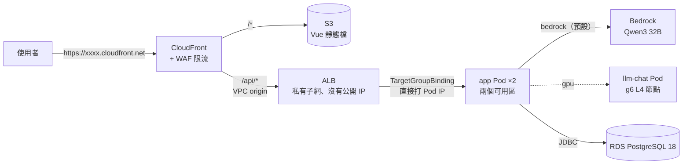
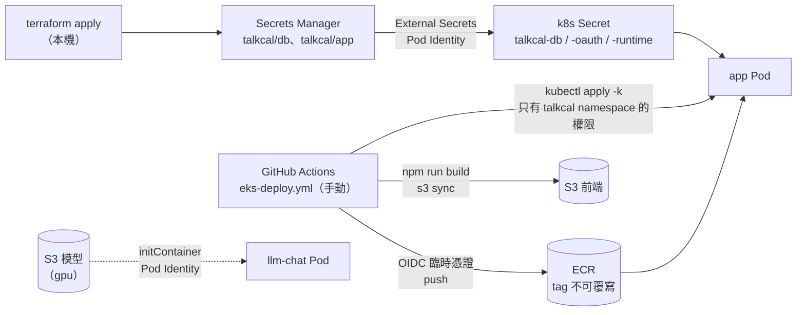
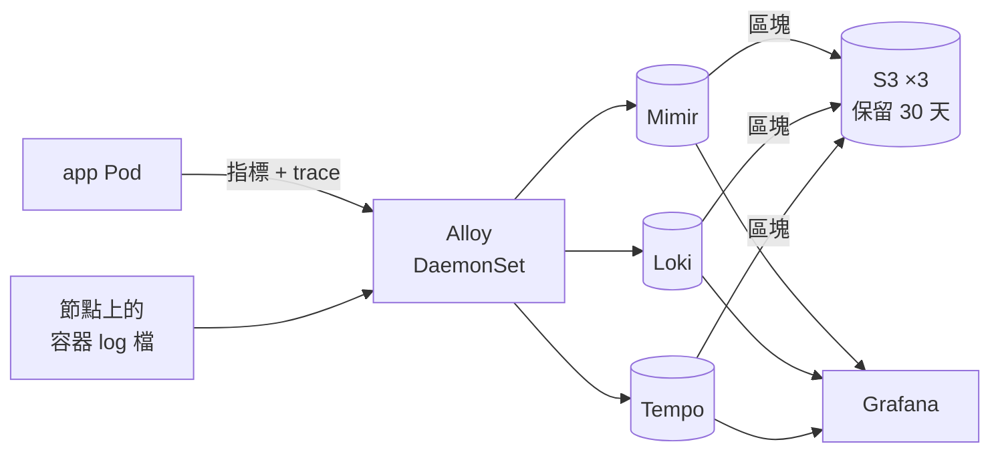

# 2-eks — 階段二：EKS

狀態：**Terraform 寫好、還沒 apply 過**（2026-10-16，[#58](https://github.com/Anderson-chen/talkcal/issues/58)）。
`terraform validate`、`terraform fmt -check` 通過；需要 AWS 憑證的 `terraform plan` 沒跑。開著每小時約 0.47 USD（見[成本估算](#成本估算)），
所以這個階段的用法是**要展示、要練 rollout 時 apply，練完 destroy**，不常駐；平常在線上的是 [1-ec2](../1-ec2/README.md)。
整體的階段怎麼分見 [infra/README.md](../../README.md)，為什麼這樣選見 [docs/adr/](../../../docs/adr/README.md)。

原則是**同一份映像檔、同一套 manifest**，只把「本機扮演的角色」換成雲端對應的東西：
k8s 的部分是 #56 的 `deploy/k8s/base` 加這次的 `deploy/k8s/overlays/eks`，跟 kind 只差 overlay。

## 1. 使用者的請求怎麼走



跟本機比少了 `web`（nginx）：靜態檔改由 S3 送，`/api` 由 CloudFront 經 ALB 直接到 app，nginx 的限流搬到 WAF（[ADR 0005](../../../docs/adr/0005-cloudfront-s3-waf-private-alb.md)）。

## 2. 程式、模型、祕密怎麼送進叢集



## 3. 觀測資料怎麼流（ADR 0003，Terraform 只先建好 bucket 和權限）



觀測那組的 manifest 要等 #56 的 `ops/k8s` 定下來，再補一個 storage 換成 S3 的 overlay（後續工作）。

## 網路怎麼切

VPC `10.1.0.0/16`（跟 1-ec2 的 `10.0.0.0/16` 錯開），跨兩個可用區，每一層兩區各一個子網。

| 子網 | 放什麼 | 誰連得到 |
|---|---|---|
| 公有 `/24` | NAT Gateway（預設兩區共用一個） | — |
| 私有 `/20` | EKS 節點、Pod、私有 ALB | ALB 只收 VPC 內（CloudFront VPC origin）；Pod 的 8090 只收 ALB。往外經 NAT；S3（含 ECR 的映像檔層）走免費的 gateway endpoint |
| 資料庫 `/24` | RDS | 只有叢集安全群組連得到 5432；沒有往外的路由 |

私有子網用 `/20`：VPC CNI 讓每個 Pod 拿一個 VPC 的 IP，`/24` 很快就不夠。

## 本機 → EKS 對照

| 本機（compose / kind） | EKS | 在哪裡 |
|---|---|---|
| `web`（nginx 送靜態檔、轉 `/api`） | CloudFront + S3；`/api/*` 經 VPC origin 到私有 ALB | `cloudfront.tf`、`alb.tf` |
| nginx 的 `limit_req`（#12、#103） | WAF 的 rate-based rule，數字照抄（登入那條因 WAF 下限從 5 變 10） | `waf.tf` |
| kind 的 NodePort | `TargetGroupBinding`：ALB controller 把 Pod IP 註冊進 Terraform 建的 target group | `alb.tf`、`overlays/eks/target-group-binding.yaml` |
| readinessProbe | 加上 ALB 的 readiness gate：新 Pod 要 ALB 健康檢查也過了才算 ready | `addons.tf` 的 namespace 標籤 |
| `stop_grace_period: 2m30s` | 沿用 base 的 `terminationGracePeriodSeconds: 150`；ALB 的 `deregistration_delay` 設 130 秒 | `alb.tf` |
| `postgres` 容器 + volume | RDS PostgreSQL 18（db.t4g.micro、自動備份 7 天） | `rds.tf` |
| `deploy/.env` 的密碼 | DB 密碼用 ephemeral + write-only 送給 RDS 和 Secrets Manager，**不進 state**；External Secrets 同步成 k8s Secret | `rds.tf`、`secrets.tf`、`overlays/eks/external-secrets.yaml` |
| `llm-chat`（本機 GPU） | 預設 Bedrock（跟 1-ec2 同一把專用 key）；`model_backend=gpu` 時 Bottlerocket NVIDIA 的 g6 節點 | `bedrock.tf`、`eks.tf`、`overlays/eks-gpu` |
| `docker build` 存本機 | GitHub Actions build → ECR（OIDC，沒有長期 key） | `ecr.tf`、`github.tf`、`.github/workflows/eks-deploy.yml` |
| Caddy + sslip.io 的 HTTPS | CloudFront 自帶 `*.cloudfront.net` 的憑證 | `cloudfront.tf` |
| SSM 登入機器 | 節點一樣掛 `AmazonSSMManagedInstanceCore`，不開 22 | `eks.tf` |

## 檔案

| 檔案 | 做什麼 |
|---|---|
| `backend.tf`、`backend.hcl.example` | state 放 bootstrap 的 bucket，key `2-eks/terraform.tfstate`；provider 版本 |
| `providers.tf` | aws（東京 + us-east-1 給 WAF）、kubernetes、helm（憑證用 `aws eks get-token` 現拿） |
| `variables.tf` | `model_backend`、節點機型／台數／Spot、NAT 要不要每區一個、RDS、CloudFront 逾時、GitHub repo |
| `vpc.tf` | 兩區 × 三層子網、NAT、S3 gateway endpoint；gpu 時只挑有 g6 的可用區 |
| `eks.tf` | 叢集（1.37、只用 access entry）、一般節點群組、GPU 節點群組（gpu）、四個代管 add-on + EBS CSI |
| `pod-identity.tf` | 每個要 AWS 權限的 ServiceAccount 一個角色：ALB controller、External Secrets、EBS CSI、觀測、llm-chat |
| `policies/aws-load-balancer-controller.json` | ALB controller 官方的 IAM 政策（v3.6.0 原樣，升 chart 時一起換） |
| `addons.tf` | helm：ALB controller、External Secrets；`talkcal` namespace、部署角色的 RBAC、gp3 StorageClass |
| `rds.tf` | RDS 和它的安全群組、`talkcal/db` 祕密 |
| `secrets.tf` | `talkcal/app` 祕密：DB 位址、模型位址／key／名稱、Google／GitHub 登入 |
| `bedrock.tf` | （bedrock）只能呼叫模型的 IAM user 和 90 天的 API key，跟 1-ec2 同一份設計 |
| `ecr.tf` | `talkcal/app`（gpu 再加 `talkcal/llama-server`），tag 不可覆寫、留最近 20 個 |
| `s3.tf` | 前端、Mimir、Loki、Tempo（gpu 再加模型）的 bucket |
| `alb.tf` | 私有 ALB、target group（健康檢查打 readiness）、HTTP listener |
| `cloudfront.tf` | distribution、OAC、VPC origin、`/api/*` 不快取並轉 Host 和 `CloudFront-Forwarded-Proto` |
| `waf.tf` | 三條 rate-based rule，被擋回 429 + JSON（跟 nginx 的 `@rate_limited` 同格式） |
| `github.tf` | GitHub OIDC provider、部署角色（只認 `environment: eks`）、EKS access entry |
| `outputs.tf` | 網址、kubeconfig 指令、要填進 GitHub environment 的變數、OAuth 回呼網址 |

k8s 的部分在 [deploy/k8s/overlays/eks](../../../deploy/k8s/overlays/eks/kustomization.yaml)（Bedrock）和 [eks-gpu](../../../deploy/k8s/overlays/eks-gpu/kustomization.yaml)。

## 成本估算

東京 ap-northeast-1、隨選價、一個月 730 小時，USD，2026-10-16 查的。流量用作品集的量估（每月幾千個請求），按量計費的項目幾乎是 0。

| 項目 | 規格 | 每小時 | 每月 |
|---|---|---:|---:|
| EKS 控制平面 | 標準支援 | 0.100 | 73.0 |
| 一般節點 | t3.large × 2（0.1088/h） | 0.218 | 158.9 |
| 節點磁碟 | gp3 30 GB × 2（0.096/GB-月） | 0.008 | 5.8 |
| NAT Gateway | 1 個（0.062/h，流量 0.062/GB 另計） | 0.062 | 45.3 |
| 公有 IPv4 | NAT 的 EIP（0.005/h） | 0.005 | 3.7 |
| ALB | 0.0243/h + 約 1 LCU（0.008/h） | 0.032 | 23.6 |
| RDS | db.t4g.micro 單 AZ（0.025/h）+ gp3 20 GB | 0.029 | 21.0 |
| WAF | web ACL 5 + 規則 3 × 1（每百萬請求 0.6 另計） | 0.011 | 8.0 |
| Secrets Manager | 2 份 × 0.40 | 0.001 | 0.8 |
| CloudWatch Logs | 控制平面的 audit、authenticator log，估 2 GB | 0.002 | 1.5 |
| CloudFront、S3、ECR、Bedrock | 免費額度內／按量，作品集的量 | ~0 | < 2 |
| **合計（預設）** | | **≈ 0.47** | **≈ 343** |

其他配置：

| 配置 | 怎麼設 | 每小時 | 每月 |
|---|---|---:|---:|
| 預設 | 什麼都不改 | ≈ 0.47 | ≈ 343 |
| 最省（節點用 Spot） | `-var node_capacity_type=SPOT`（t3.large Spot 約 0.04/h） | ≈ 0.33 | ≈ 240 |
| 不放觀測、節點縮小 | `-var node_instance_type=t3.medium`（0.0544/h） | ≈ 0.36 | ≈ 263 |
| 每區一個 NAT（高可用） | `-var nat_per_az=true` | +0.067 | +49 |
| RDS 多 AZ | `-var db_multi_az=true` | +0.025 | +18 |
| GPU 自架模型 | `-var model_backend=gpu`：g6.xlarge 1.1672/h + 80 GB 磁碟 + 20 GB PVC | ≈ 1.65 | ≈ 1,205 |
| 節點縮到 0 但叢集留著 | 控制平面 + NAT + ALB + RDS + WAF 照收 | ≈ 0.24 | ≈ 177 |
| **destroy** | `terraform destroy` | **0** | **0** |
| 對照：1-ec2 | m7i-flex.large 一台（0.124/h）+ 30 GB 磁碟 + 公有 IPv4 | ≈ 0.13 | ≈ 97 |

**展示一次的成本**：apply 約 20 分鐘、展示 2 小時、destroy 約 15 分鐘，約 2.6 小時 × 0.47 ≈ 1.2 USD。

要注意的：

- **固定費用佔大半**：控制平面、NAT、ALB 不管有沒有流量都在收，節點縮到 0 也省不掉——所以省錢的做法是 destroy，不是關機。
- **Kubernetes 版本過了標準支援**（約 14 個月）控制平面變 0.60/h（每月 438），要每年升版。
- 單價來源：EKS（[cloudburn](https://cloudburn.io/blog/amazon-eks-pricing)）、t3.large（[Holori](https://calculator.holori.com/aws/ec2/t3.large/ap-northeast-1)、[DoiT](https://www.doit.com/compute/spot/ap-northeast-1/t3.large)）、
  g6.xlarge（[DoiT](https://www.doit.com/compute/spot/ap-northeast-1/g6.xlarge)）、NAT（[cloudburn](https://cloudburn.io/blog/aws-nat-gateway-pricing)）、
  RDS（[issoh](https://www.issoh.co.jp/tech/details/17883/)）、CloudFront 免費額度（[AWS](https://aws.amazon.com/cloudfront/pricing/)）。
  第三方整理的數字，apply 前用 [AWS Pricing Calculator](https://calculator.aws/) 再對一次；ALB（0.0243/h、LCU 0.008/h）、WAF、EBS gp3（0.096/GB）、Secrets Manager 是憑過去的東京價寫的，這次沒有另外查證。
- bootstrap 的花費告警（[infra/bootstrap](../../bootstrap/main.tf)）兩個階段共用，忘了 destroy 會寄信。

## 首次部署

前提：AWS CLI 的 `DEV` profile 登入得了、[bootstrap](../../bootstrap/main.tf) 跑過、本機有 `kubectl`。
`gpu` 還要 GPU 配額（「Running On-Demand G and VT instances」，2026-10-13 申請被拒，見 [#72](https://github.com/Anderson-chen/talkcal/issues/72)）。

```bash
cd infra/envs/2-eks
cp backend.hcl.example backend.hcl        # 填入 bootstrap 輸出的 state_bucket
terraform init -backend-config=backend.hcl
# （要開 Google、GitHub 登入才做）cp oauth.auto.tfvars.example oauth.auto.tfvars 再填值
terraform apply                           # 約 20 分鐘，大部分在等 EKS 控制平面和 CloudFront
$(terraform output -raw kubeconfig_command)
kubectl -n talkcal get externalsecrets    # 三個都要是 SecretSynced
```

接著設定 GitHub（只要一次，叢集重建後要更新值）：

1. repo → Settings → Environments → 新增 `eks`（建議勾 Required reviewers）
2. Variables 填 `terraform output github_environment_variables` 的每一項（gpu 再加 `MODELS_BUCKET`）
3. Actions → **Deploy to EKS** → Run workflow

```bash
terraform output -raw app_url             # 開這個網址
```

gpu 時先傳模型（跟 1-ec2 一樣要連 SHA256SUMS 一起傳，initContainer 會驗）：

```bash
aws s3 cp C:/llm/models/Qwen3-8B-Q4_K_M.gguf "s3://$(terraform output -raw models_bucket)/models/" --profile DEV
aws s3 cp C:/llm/models/SHA256SUMS            "s3://$(terraform output -raw models_bucket)/models/" --profile DEV
```

## 日常操作

```bash
# 部署新版、回退到舊版：都是在 Actions 選那個 commit／tag 跑 Deploy to EKS
kubectl -n talkcal rollout status deployment/app
kubectl -n talkcal get pods -o wide                 # 兩份 app 應該在不同可用區的節點上
kubectl -n talkcal logs deploy/app --tail=100

# Bedrock key 到期前換新（預設 90 天）：External Secrets 一小時內同步，再重啟 app 讀新的環境變數
terraform apply -replace='aws_iam_service_specific_credential.bedrock[0]'
kubectl -n talkcal annotate externalsecret talkcal-runtime force-sync=$(date +%s) --overwrite   # 不想等一小時
kubectl -n talkcal rollout restart deployment/app

# 換 DB 密碼：variables.tf 的 db_password_version 加一（密碼不在 state 裡，Terraform 只看這個數字）
terraform apply -var db_password_version=2
kubectl -n talkcal annotate externalsecret talkcal-db force-sync=$(date +%s) --overwrite
kubectl -n talkcal rollout restart deployment/app

# GPU 節點沒人用時縮到 0（節點群組留著）
terraform apply -var model_backend=gpu -var gpu_node_count=0
```

## 省錢

**展示完就 `terraform destroy`。** 這個階段沒有「關機」：控制平面、NAT、ALB 停不了。
destroy 會一起刪掉 RDS（不留快照）、ECR 裡的映像檔、S3 的前端和觀測資料——都可以從 git 重建；行程資料要留的話先做 #45 的備份。
Secrets Manager 的兩份祕密設成立刻刪除（`recovery_window_in_days = 0`），下次 apply 才建得回同名的。

## 已知限制

| 限制 | 原因 | 怎麼解 |
|---|---|---|
| AI 回答超過 60 秒會 504 | CloudFront 等 origin 預設最多 60 秒；app 最久等模型 2 分鐘 | Service Quotas 申請提高 origin response timeout（最多 180），再 `-var api_origin_read_timeout=180`；或改串流回應 |
| 登入限流比 nginx 寬（10 vs 5 次／分） | WAF 的 rate limit 最低 10 | 接受；BCrypt 本身就慢 |
| 觀測那組還沒部署 | 要等 #56 的 `ops/k8s`；app 送 trace 的位址（`alloy.talkcal-ops`）在那之前連不到，只會在 log 留警告 | 後續補 `ops/k8s/overlays/eks`（storage 換成 S3） |
| `kubectl kustomize deploy/k8s/overlays/eks` 現在會失敗 | base 和 components 在 #56，還沒合併 | #56 合併後就好；這次用 #56 的草稿驗過能 build |
| app 用 RDS 的主帳號連 | 先求能動 | 另建只有 talkcal 資料庫權限的帳號（#45 一起做） |

## 靜態檢查

`terraform validate`、`terraform fmt -check` 通過。`trivy config`（跟 CI 同一個映像檔 `aquasec/trivy:0.74.0`）HIGH 以上的結果，評估後接受：

| 規則 | 說什麼 | 為什麼接受 |
|---|---|---|
| AWS-0054 | ALB listener 用 HTTP | ALB 在私有子網，只有 CloudFront VPC origin 連得到；HTTPS 要嘛買網域拿 ACM 憑證、要嘛 Private CA（每月 400 USD）。使用者到 CloudFront 那段是 HTTPS |
| AWS-0039 | EKS 沒設 secret 的自管 KMS 加密 | EKS 1.28 起 API 資料預設就用 AWS 的金鑰做信封加密；自管 key 換來的是自己能停用、稽核，作品集用不到 |
| AWS-0040、0041 | EKS 公開端點、來源全開 | GitHub 代管 runner 的 IP 不固定；端點靠 IAM 認證擋。可用 `cluster_public_access_cidrs` 收窄 |
| AWS-0132 ×4 | S3 沒用自管 KMS key | SSE-S3 已加密；自管 key 每把每月 1 USD 加請求費 |

## 已經決定的

| 問題 | 選擇 | 紀錄 |
|---|---|---|
| 跑容器的平台 | EKS 1.37 + managed node group，Pod 權限用 Pod Identity | [ADR 0001](../../../docs/adr/0001-eks-with-managed-node-groups.md) |
| 模型自己架還是託管；GPU 要不要一直開 | 預設 Bedrock；`model_backend=gpu` 才建 GPU 節點，`gpu_node_count` 手動縮到 0 | [ADR 0002](../../../docs/adr/0002-model-bedrock-default-gpu-optional.md) |
| 觀測自架還是託管 | 叢集內自架，區塊存 S3 | [ADR 0003](../../../docs/adr/0003-self-hosted-observability-on-s3.md) |
| 部署怎麼推 | GitHub Actions `kubectl apply -k`，手動觸發；先不上 Argo CD | [ADR 0004](../../../docs/adr/0004-push-deploy-from-github-actions.md) |
| 前端、入口、限流 | CloudFront + S3、VPC origin 進私有 ALB、WAF 限流 | [ADR 0005](../../../docs/adr/0005-cloudfront-s3-waf-private-alb.md) |
| Terraform 寫法 | 直接寫 `aws_eks_*` 資源，不用 terraform-aws-modules | ADR 0001 |
| DB 密碼 | ephemeral + write-only，不進 state；不用 RDS 自動輪替（祕密名稱會變、輪替後 app 要重啟） | `rds.tf` |

## 待決定

| 問題 | 選項 | 目前傾向 |
|---|---|---|
| 要不要 staging | 同叢集另一個 namespace / 另一個叢集 | 跟 [#24](https://github.com/Anderson-chen/talkcal/issues/24) 一起：#24 先在 1-ec2 的同一台機器上做了，EKS 上用 namespace `talkcal-staging` 最省 |
| canary 用什麼 | Argo Rollouts / ALB 加權 target group | 跟 [#20](https://github.com/Anderson-chen/talkcal/issues/20) 一起；Argo Rollouts 可以不裝 Argo CD 單獨用 |
| 自訂網域 | `*.cloudfront.net` / Route 53 + ACM | 先不買網域 |
