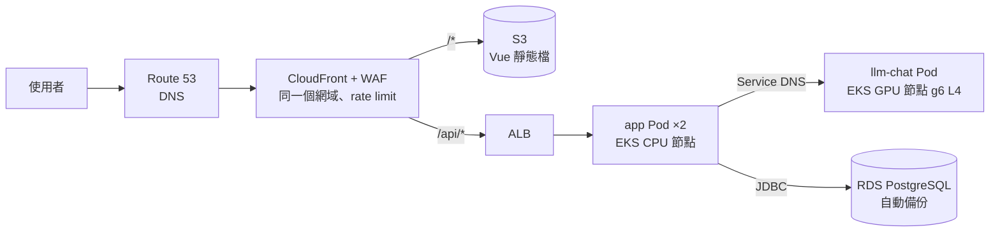
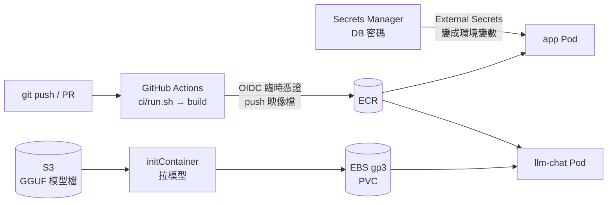
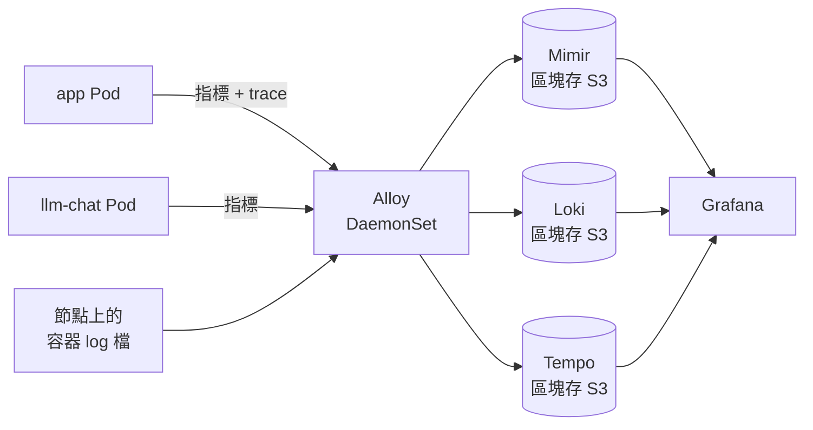

# 2-eks — 階段二：EKS

狀態：**規劃中**，追蹤在 [#58](https://github.com/Anderson-chen/talkcal/issues/58)，要等階段一（[1-ec2](../1-ec2/README.md)）和本機 k8s（[#56](https://github.com/Anderson-chen/talkcal/issues/56)）。整體的階段怎麼分見 [infra/README.md](../../README.md)。

原則是**同一份映像檔、同一套觀測**，只把「本機扮演的角色」換成雲端對應的東西。
對應關係在 [deploy/README.md 的「對照雲端」](../../../deploy/README.md#對照雲端)已經列過，這裡把它畫成 AWS 的元件，同樣拆成三張。

## 1. 使用者的請求怎麼走

## 2. 程式、模型、祕密怎麼送進叢集

三條線各自獨立：程式走映像檔、模型走 S3、密碼走 Secrets Manager。

## 3. 觀測資料怎麼流

跟本機同一套，差別只有兩個：Alloy 改成每台節點一個（DaemonSet）讀節點上的 log 檔，三個資料庫的區塊改存 S3。

## 網路怎麼切

VPC 跨兩個可用區，每一層的子網兩區各一個。

| 子網 | 放什麼 | 誰連得到 |
|---|---|---|
| 公有 | ALB、NAT Gateway | ALB 只收 CloudFront 來的流量 |
| 私有（EKS） | app、llm-chat、Alloy、觀測三件套、Grafana | 只有 ALB 進得來；往外連經 NAT。ECR、S3 改走 VPC endpoint，拉映像檔和模型不必繞 NAT、也省 NAT 流量費 |
| 資料庫 | RDS | 只有 EKS 節點的 security group 連得到 5432 |

## 本機 → EKS 對照

| 本機 | AWS | 為什麼換 |
|---|---|---|
| `web`（nginx 送靜態檔、轉 `/api`） | CloudFront + S3，`/api/*` 轉給 ALB | 靜態檔放邊緣快取；瀏覽器看到的還是同一個網域，app 照樣不用開 CORS |
| `127.0.0.1` 綁定 | 私有子網，只有 ALB 在公有子網 | 對外只開一個入口 |
| （沒有） | WAF 的 rate-based rule | 濫用防護（[#12](https://github.com/Anderson-chen/talkcal/issues/12)），一次問答要叫模型，被刷很貴 |
| 服務名稱 `app`、`llm-chat` | k8s Service 的 DNS | 同一套「用名字找」的規則 |
| `depends_on` + `healthcheck` | readinessProbe / startupProbe | 載模型期間不導流量；app 已經有分開的 `/actuator/health/liveness`、`/readiness`（management 埠 8091，[#33](https://github.com/Anderson-chen/talkcal/issues/33)），probe 直接打 |
| `stop_grace_period: 2m30s` | `terminationGracePeriodSeconds: 150` | 沿用 graceful shutdown 的實驗結果（[postmortem](../../../docs/postmortems/)） |
| `deploy.resources: nvidia` | GPU 節點群組 + `nvidia.com/gpu: 1` | k8s 是一個 Pod 獨佔一張卡，不像 Docker Desktop 大家共用 |
| `model-seed` + `models` volume | initContainer 從 S3 拉到 EBS（PVC） | 同一個設計：慢的來源只讀一次，模型服務只讀本機磁碟 |
| `C:\llm\models` | S3 bucket | 模型檔的唯一來源 |
| `postgres` 容器 + volume | RDS PostgreSQL | 備份、修補、故障轉移交給託管服務（[#45](https://github.com/Anderson-chen/talkcal/issues/45)） |
| compose 裡寫死的 `POSTGRES_PASSWORD` | Secrets Manager → External Secrets → 環境變數 | 祕密不進版控（[#14](https://github.com/Anderson-chen/talkcal/issues/14)） |
| `docker build` 存在本機 | GitHub Actions build → ECR | PR 合併才出映像檔；用 OIDC，不存長期的 AWS 金鑰 |
| Alloy 讀 `docker.sock` | Alloy DaemonSet 讀節點上的 log 檔 | `docker.sock` 等於整台主機的控制權，雲端不這樣開 |
| Mimir / Loki / Tempo 存 volume | 同樣三個，區塊存 S3 | 三者都原生支援 S3；設定只換 storage 那一段，Grafana 儀表板不用動 |

## 待決定（階段二）

| 問題 | 選項 | 目前傾向 |
|---|---|---|
| 跑容器的平台 | EKS / ECS | EKS：deploy/ 的下一步本來就是換成 kind 跑 k8s，練到的東西能直接搬上去 |
| 模型自己架還是用託管 | GPU 節點自架 / 換成託管 API | 先算成本再決定（[#35](https://github.com/Anderson-chen/talkcal/issues/35)）。app 走 OpenAI 相容協定，換的話只改設定 |
| GPU 節點要不要一直開 | 常駐 / 沒人用時縮到 0 | 作品集流量很低，GPU 是最大的開銷；縮到 0 的代價是第一個請求要等開機和載模型 |
| 觀測要自己架還是用託管 | 叢集內自架 + S3 / Amazon Managed Prometheus + Managed Grafana / Grafana Cloud | 自架：跟本機同一套設定，最能展示「搬得動」 |
| 部署怎麼推上去 | GitHub Actions 直接 `helm upgrade` / Argo CD（GitOps） | 未定，跟 rollback（[#19](https://github.com/Anderson-chen/talkcal/issues/19)）、canary（[#20](https://github.com/Anderson-chen/talkcal/issues/20)）一起想 |
| 要不要 staging | 同叢集另一個 namespace / 另一個帳號 | 跟 [#24](https://github.com/Anderson-chen/talkcal/issues/24) 一起決定 |
