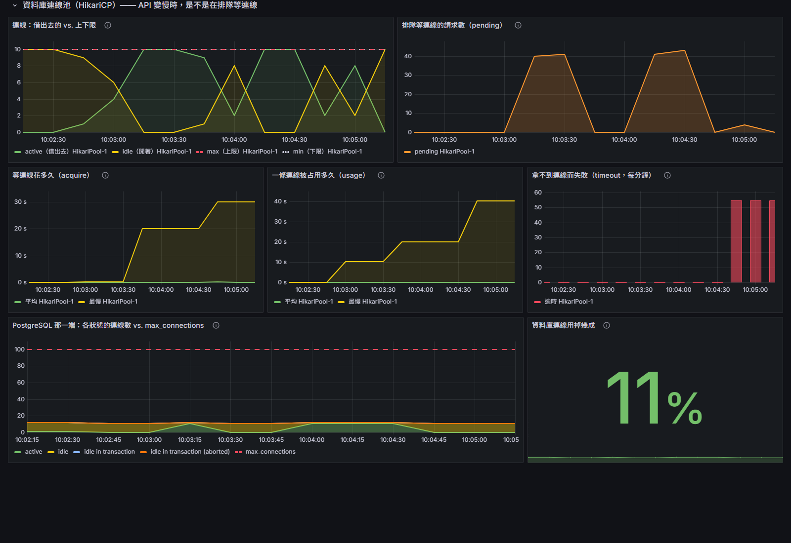

# perf —— 負載測試（k6）

用 [k6](https://k6.io) 從 HTTP 那頭壓 AI 助理 `POST /api/calendar/assistant`，量它在併發下的延遲與吞吐。
助理一輪是一段 agent loop（可能叫模型好幾次、會讀寫 PostgreSQL），細節見 `lib/assistant.js` 開頭。
跟 `ops/`（觀測環境）、`backend/`（app）平行，是**獨立的一個關注點**：k6 不進 `backend/`，
app 也不知道有人在壓它。

## 先決條件

壓的是**真的**這條路，不是假的 mock，所以這幾樣都要先在跑：

| 要跑的東西 | 怎麼起 | 埠 |
|------------|--------|----|
| llama.cpp server | 你平常那台常駐的 | 8080 |
| PostgreSQL | `docker compose -f deploy/compose.yaml up -d postgres` | 5432 |
| talkcal app | `backend/` 裡 `./gradlew bootRun` | 8090 |

/api 要登入（#103）：每支腳本的 `setup()` 會先註冊（已經有就略過）、登入一次，所有 VU 共用那個 session
（nginx 對登入限流，每個 VU 各自登入會被 429 擋下）。帳號預設是 `perf-user`，要換就設 `PERF_USER`、`PERF_PASSWORD`。
| k6（打壓的工具） | 見下方安裝 | — |

llama.cpp 沒開也能跑 smoke，只是「正常訊息回 200」那條會紅、「空白訊息回 400」那條照樣綠
（那條不碰模型、也不碰資料庫）—— 這正好幫你分辨是「整條路壞了」還是「只有模型層 down」。

## 安裝 k6（Windows）

三選一，裝哪個都行：

```powershell
winget install --id GrafanaLabs.k6
```

```powershell
choco install k6
```

```powershell
scoop install k6
```

裝完開新的終端機，`k6 version` 有印版本就成了。

## 怎麼跑

app 起在 8090 之後：

```bash
k6 run perf/smoke.js
```

指到別台機器不必改腳本，覆蓋 `BASE_URL` 就好：

```powershell
$env:BASE_URL="http://192.168.0.10:8090"; k6 run perf/smoke.js
```

### 想邊跑邊看圖、或要一份報告

k6 自帶一個網頁儀表板，不必架 Grafana。加 `--out web-dashboard`，跑的當下開
`http://localhost:5665` 就有即時圖；再設 `K6_WEB_DASHBOARD_EXPORT` 收工會存一份
自帶圖表、離線可開的 HTML 報告：

```powershell
$env:K6_WEB_DASHBOARD_EXPORT="perf/results/smoke-report.html"; k6 run -o web-dashboard perf/smoke.js
```

（報告是「跑出來的結果」不是原始碼，`perf/results/` 已被 `.gitignore` 擋掉，不會進版控。）
這條路零設定、最快看到東西；要把壓測曲線跟 app／llama.cpp 的指標**疊在同一張圖**上看，
走下面「接進 Grafana」那條。

### 接進 Grafana：跟 app、模型的指標疊在同一個時間軸

先起 `ops/`（`docker compose --env-file deploy/.env -f ops/compose.yaml up -d`），然後把 `k6 run` 換成這支（Git Bash）：

```bash
perf/run-to-grafana.sh perf/knee.js
```

腳本自己的參數照常用環境變數給，後面多的參數原樣交給 `k6 run`：

```bash
STEPS=1,2,4,8 HOLD_S=15 perf/run-to-grafana.sh perf/knee.js
```

開 Grafana 的 **talkcal — 壓測（k6）**（<http://localhost:3000/d/talkcal-k6>）：上排是 k6 看到的（VU、請求速率、延遲、失敗率），
下排是同一段時間 app 和模型在做什麼。腳本只是幫你設好 k6 送 OTLP 給 Alloy 的那幾個環境變數，每一個為什麼要設寫在
[run-to-grafana.sh](run-to-grafana.sh) 裡；指標怎麼從 Alloy 進到 Mimir 見 [ops/README.md](../ops/README.md) 的「壓測」那一段。

注意 app 那條線只看得到 **docker 那台 app**（18090）：Alloy 只抓它的指標，本機 bootRun 的不會被抓。
要對照 server 那頭，就壓 docker 那台（`concurrent.js`、`knee.js` 預設就是）。

### load：找併發上限

全程約 4~5 分鐘，會把 llama-server 壓到超過容量：

```bash
k6 run perf/load.js
```

只想先確認腳本沒寫錯，把每段縮成 10 秒（約 2 分鐘；樣本少，數字只看趨勢）：

```powershell
$env:HOLD_S="10"; k6 run perf/load.js
```

llama-server 改了 `-np`（slot 數）時，用 `SLOTS` 對上，三段平台會跟著變：

```powershell
$env:SLOTS="2"; k6 run perf/load.js
```

跑的時候開著 Grafana 的 **llama.cpp — LLM server** 與 **talkcal — Spring app** 兩張 dashboard，
`above` 那段會看到「排隊中」離開 0、p95 往上跳。

### concurrent 與 knee：預設打 docker 那台 app

這兩支預設打 **docker 那台 app**（`deploy/compose.yaml` 的 `18090`，見 `lib/docker-target.js`）。
要打本機 bootRun 就覆蓋 `BASE_URL`：

```powershell
$env:BASE_URL="http://localhost:8090"; k6 run perf/knee.js
```

#### concurrent：一波人在短時間內湧進來

`USERS` 個人在 `WINDOW_S` 秒內陸續進來，每人只說一句就走——像活動開始、大家同時打開網頁的尖峰。
用 `constant-arrival-rate`：k6 照固定節奏開始新請求，不管前面的回來了沒。預設 1000 人 / 60 秒。

```bash
k6 run perf/concurrent.js
```

```powershell
$env:USERS="50"; $env:WINDOW_S="5"; k6 run perf/concurrent.js     # 小一點的尖峰
```

看 `http_req_duration` 的 min 與 max 差多少（越晚來的人前面排越多），
有 `dropped_iterations` 就代表 k6 沒送到設定的人數，數字不能信。

#### knee：同時數一階一階往上加，找臨界值

每一階固定 N 個人持續說（說完立刻再說，預設每次都說「明天有什麼行程？」），收工印一張表：同時數、中位延遲、p95、吞吐量。
臨界值就是**吞吐量不再增加、延遲開始往上衝**的那一列。預設階數 `1,2,3,4,5,6,8,12,16`，每階 5 秒。

```bash
k6 run perf/knee.js
```

```powershell
$env:HOLD_S="20"; k6 run perf/knee.js                 # 每階拉長，中位數比較穩
$env:STEPS="1,4,8,16,32"; k6 run perf/knee.js         # 自訂要量哪幾階
```

跟 `load.js` 的差別：load 只量三段（1、SLOTS、SLOTS×2），knee 每一階都量，看得到臨界值落在哪。
跟 `concurrent.js` 的差別：concurrent 量「一瞬間湧進 N 個」，knee 量「持續有 N 個在用」的穩定狀態。

### deploy：邊壓邊部署

部署那幾十秒裡有幾個人受影響、怎麼受影響。每分鐘固定來 `RATE_PER_MIN` 個人（預設 20）、各說一句，
app 掛了也不會因此多送，所以失敗數 ≈ 部署期間進來的人數。先起 ops/，然後：

```bash
perf/run-to-grafana.sh perf/deploy.js
```

大約 60 秒後，在另一個終端機部署：

```bash
cd backend && ./gradlew deployApp -x test
```

收工印一張表，把失敗分成「一送就失敗」（app 不收或還沒起來）、「等了一陣子才失敗」（連線被砍）、「拿到錯誤碼」。
Grafana 的「talkcal — 壓測（k6）」上，紅線是舊 app 收到 SIGTERM、綠線是新版起好。

**別拿 knee.js 壓部署**：它的人說完立刻再說，app 停掉的十幾秒裡每個請求幾毫秒就失敗、立刻重送，
會刷出幾萬個失敗，數字只反映重送得多快。用這支量出來的結果和經過見
[第一份 postmortem](../docs/postmortems/2026-10-12-deploy-cuts-in-flight-requests.md)。

`RATE_PER_MIN` 要低於容量：每分鐘 60 人、問題隨機混合時模型的 KV cache 會塞爆、回 502，跟部署無關的失敗混進來就分不清了。

### outage：模型掛掉演練（#44）

模型斷線、卡住、變慢的時候，助理是不是快速失敗、行程 API 是不是照常可用。同時跑兩群人：每分鐘 `RATE_PER_MIN` 個人（預設 20）跟助理說一句，
每秒 1 個人讀行程。故障由腳本自己透過 Toxiproxy 按時製造（第 60 秒弄壞、第 180 秒恢復），每一句的結果都印一行（帶時間），對著看。

deploy/ 要疊 `compose.chaos.yaml` 起，app 和模型、資料庫中間才有 Toxiproxy（見 [deploy/README.md](../deploy/README.md#故障演練toxiproxy)）：

```bash
docker compose -f deploy/compose.yaml -f deploy/compose.chaos.yaml up -d
```

```bash
FAULT=down k6 run perf/outage.js                                      # 斷線：幾毫秒就失敗
```

```bash
FAULT=slow k6 run perf/outage.js                                      # 每個回應慢 40 秒（SLOW_MS），超過 30 秒的慢呼叫門檻
```

```bash
FAULT=hang DURATION_S=360 RECOVER_AT_S=220 k6 run perf/outage.js      # 卡住：連得上、永遠不回，要等到逾時
```

```bash
PROXY=postgres FAULT=down DURATION_S=180 RECOVER_AT_S=120 k6 run perf/outage.js   # 反例：弄壞資料庫那段，斷路器不該動
```

不給 `FAULT` 就不碰 Toxiproxy，由你在另一個終端機自己弄壞（`toxiproxy-cli` 的指令見 [deploy/README.md](../deploy/README.md#故障演練toxiproxy)）。

收工的表：助理的 200、502、503（MODEL_UNAVAILABLE／MODEL_BUSY）各幾個、中位數和最久花多久；行程 API 有門檻（0 失敗、p95 < 1 秒），
所以弄壞資料庫那次 k6 會以非 0 結束 —— 那次本來就該失敗。
斷路器的門檻和理由在 `backend/src/main/resources/application.properties` 的 `resilience4j.*`（`chat-model`）。
實際跑過的結果：[2026-10-29 用 Toxiproxy](../docs/drills/2026-10-29-toxiproxy/README.md)（斷線、變慢、卡住、資料庫斷線的反例）、
[2026-10-19 手動停容器](../docs/drills/2026-10-19-model-outage/README.md)。

### slo：平常流量，量 SLO 的基準、驗 burn-rate 告警

行程 CRUD 為主（每秒 `CRUD_RPS` 個，預設 10）、每分鐘跟助理說 `ASSIST_PER_MIN` 句（預設 6），跑 `DURATION`（預設 2m）。
用固定到達速率：使用者照常來，不會因為 server 變慢就少來，SLO 算的「幾成被好好服務」才對。
收工分開印行程 API 和助理的 p95、p99、失敗率，[docs/slo.md](../docs/slo.md) 的門檻就是從這裡量出來的。

```bash
k6 run perf/slo.js
CRUD_RPS=50 ASSIST_PER_MIN=0 DURATION=60s k6 run perf/slo.js     # 只壓行程 API，5 倍量
```

開著它當背景流量，再弄壞一個依賴（停資料庫、模型位址指錯），SLO 儀表板的 burn rate 會往上衝、告警進 firing；
依賴恢復、只剩這支的時候不該響。做法和結果見 docs/slo.md 的「驗證」。

### db-pool：把資料庫連線池壓到不夠用

其他腳本都壓 AI 助理，瓶頸在模型，連線池永遠用不滿。這支改壓只碰資料庫的 `GET /api/calendar/events`，
看 Grafana 的 **talkcal — Spring app** 的「資料庫連線池」那一排（#32）：

```bash
perf/run-to-grafana.sh perf/db-pool.js
```

**實測（2026-10-17，池子 10 條、Tomcat 200 條執行緒、4 核）**：只壓讀取壓不滿池子。
150 VU 起吞吐量就停在約 1,540 req/s，一條連線平均只占 3.6 毫秒，算下來平均同時只借出約 5.5 條
（Little's Law：1,540 × 0.0036），pending 只偶爾跳到個位數。先撐不住的是 CPU 和 JSON 序列化，不是連線池 ——
這個 app 照現在的查詢，池子 10 條是夠的。

池子真正會不夠，是**查詢變慢**的時候：連線借出去還不回來。用鎖表模擬（例如 migration 改表、有人開著交易沒關）：
50 VU 持續讀，同時在另一個終端機鎖住行程表 20 秒：

```bash
STAGES=50 HOLD_S=140 perf/run-to-grafana.sh perf/db-pool.js
```

```bash
docker exec talkcal-postgres psql -U talkcal -d talkcal -c "BEGIN; LOCK TABLE calendar_event IN ACCESS EXCLUSIVE MODE; SELECT pg_sleep(20); COMMIT;"
```

| 鎖多久 | active | pending | 逾時 | 使用者看到的 |
|--------|--------|---------|------|--------------|
| 不鎖 | 平均約 5 | 0～個位數 | 0 | p95 不到 100 毫秒 |
| 20 秒 | 貼著上限 10 | 衝到 40（50 VU − 10 條） | 0 | 卡 20 秒後全部成功 |
| 40 秒 | 貼著上限 10 | 40 上下 | 約 40 次 | 等滿 30 秒（`connectionTimeout`）的請求回 502 |



左邊 10:03 那一段是鎖 20 秒、10:04 那一段是鎖 40 秒（截圖時間是台北時間）。
鎖表的那段時間，PostgreSQL 那張圖上 active 也是 10：10 條連線都在等鎖，不是在做事。
看到「app 的 pending 高、資料庫的 active 等於池子大小」，就知道問題在資料庫那頭，加大池子沒用。

## 怎麼讀結果

k6 收工時印一張表，看三個地方就夠：

- **`checks`** —— 契約對不對。`✓ 100%` 代表每次的狀態碼與回覆格式都正確。
  這裡任何一條紅了，就是 app 回錯東西了，先別看延遲。
- **`http_req_duration`** —— 請求耗時分佈（`avg` / `p(95)` / `max`）。
  這數字**天生就大**，因為後面掛著 LLM，見下一段。
- **`thresholds`** —— 最下面每條門檻 `✓`/`✗`。有 `✗`，k6 就以非 0 結束碼收工，
  將來接 CI 時這個結束碼就是「這次壓測算不算過」的依據。

## 為什麼延遲門檻放這麼寬？

一般 web API 會設 `p95 < 500ms`。這裡**不能**這樣設，因為每個助理請求後面是
一顆真的 LLM 在生字，而且一輪可能叫它好幾次 —— Qwen3 的 thinking 會先燒掉幾百個看不見的 token，好幾秒才回來是**正常的**。
拿毫秒級門檻來套只會全紅，量錯東西。

所以 `smoke.js` 的門檻是「離譜線」而不是「效能目標」：`p(95)<60000`（60 秒）——
超過它八成是卡住/逾時，不是慢。同樣理由，k6 每個請求的 `timeout` 放到 `120s`，
跟 app 叫一次模型的 2 分鐘逾時對齊；不然 k6 預設 60 秒先斷線，
會把「模型還在想」誤判成「app 掛了」。

**第一次請求會偏慢**：暖 KV cache 等。真的要看穩定延遲時，第一輪當暖身、別算進門檻 ——
`load.js` 就是這樣做的：第一句獨立成 `warmup` 段，不設任何門檻。

## 怎麼讀 load 的結果

`load.js` 不是一路往上加 VU，而是**三段平台**，每段維持一陣子、各自有門檻：

| 段 | VU | 意思 |
|----|----|------|
| `below` | 1 | 低於容量，當基準線 |
| `at` | `SLOTS`（預設 4） | 剛好等於 llama-server 的 slot 數，每個請求都有位子 |
| `above` | `SLOTS×2` | 超過容量，多出來的請求只能排隊 |

收工報表會分段印出 `http_req_duration{scenario:below/at/above}`，**直接比三個 p95**：

- `at` 跟 `below` 差不多 → slot 夠用，平行處理沒拖慢彼此。
- `above` 明顯跳上去（例如翻倍）→ 膝蓋就在 `SLOTS`，多的請求在排隊。

為什麼不用一路往上加（ramping）？那樣所有併發數的數字全混在一個 p95 裡，比不出「從哪裡開始變慢」。
分段的另一個好處：k6 收工報表**只印有設門檻的子指標**，所以分段門檻同時也是「讓報表分段印」的開關。

`slot 數` 怎麼查：`GET http://localhost:8080/props` 的 `total_slots`。
launch.json 的原生 llama-server 沒帶 `-np`，是 llama.cpp 的預設值（4）；
`deploy/compose.yaml` 的 llm-chat 帶了 `-np 200`，打 docker 那台時用 `$env:SLOTS="200"` 對上。

## 現在做到哪

- **`smoke.js`** —— 1 個 VU、跑幾輪，單獨證明「k6 打得到 AI 助理，兩側契約都對」。
  這是負載測試的地基：先確定路是通的，才有資格談「多少併發下會垮」。
  故意送錯的那個請求有標成「預期回 400」，所以 `http_req_failed` 是真的失敗率（應為 0%）。
- **`load.js`** —— 三段平台找併發上限，暖身不算數。
- **`concurrent.js`** —— 一波人在短時間內各說一句，看尖峰時最後來的人等多久。
- **`knee.js`** —— 同時數逐階往上加，印出每階的延遲與吞吐量，找臨界值。
- **`outage.js`** —— 模型斷線、卡住時，助理多快失敗、熔斷有沒有打開又關回來、行程 API 有沒有被拖累。
- **`db-pool.js`** —— 只壓資料庫的讀取，看連線池（HikariCP）什麼時候不夠用。
- **`tokens.js`** —— 一句一句說完訊息池，量每個請求平均燒多少 token、換算成多少錢（讀 app 的 token 指標前後相減）。
  成本分析 [docs/cost.md](../docs/cost.md) 的輸入就是它量的。
- **`lib/assistant.js`** —— 各腳本共用的位址、訊息池、請求參數、正常回覆的檢查。
- **`lib/docker-target.js`** —— 把預設位址改成 docker 那台 app，有給 `BASE_URL` 就尊重它。

## 下一步（之後才做，一次一件）

1. **對 AI 助理重新量一次基準。** 以前的數字（包括 `perf/results/` 底下的報告）都是壓 `/api/chat` 量的，
   那個端點已經拿掉。換成助理之後一輪要叫好幾次模型，膝蓋、p95 都會不一樣，要重跑 load、knee 再定門檻。
2. **換 slot 數看膝蓋移動。** launch.json 加 `-np 2` 或 `-np 8` 重啟 llama-server，配 `SLOTS` 再跑一次，
   驗證「膝蓋 = slot 數」這個假設。注意 slot 多了每個請求分到的 GPU 算力會變少，單一請求可能反而變慢。

## 檔案結構

```
perf/
├── lib/
│   ├── assistant.js      # 共用：位址、訊息池、請求參數、正常回覆的檢查
│   └── docker-target.js  # 讓腳本預設打 docker 的 app（18090）
├── smoke.js        # 最小規模的契約 + 連通性驗證
├── load.js         # 三段平台找併發上限
├── concurrent.js   # 一波人在短時間內各說一句（尖峰）
├── knee.js         # 同時數逐階往上加，找臨界值
├── deploy.js       # 邊壓邊部署：部署期間有幾個人受影響
├── outage.js       # 模型掛掉演練：助理快速失敗、行程 API 照常
├── slo.js          # 平常流量：量 SLO 的基準、驗 burn-rate 告警
├── db-pool.js      # 只壓資料庫的讀取，看連線池什麼時候不夠用
├── tokens.js       # 每個請求燒多少 token、值多少錢（docs/cost.md 用）
└── run-to-grafana.sh  # 跑任何一支腳本，指標同時送進 ops/ 的 Grafana
```
