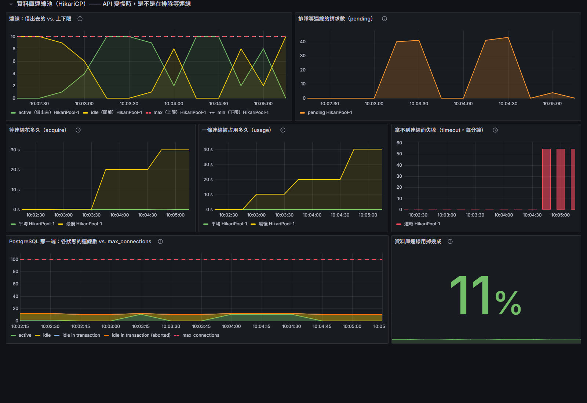

# perf：負載測試（k6）

用 [k6](https://k6.io) 從 HTTP 那頭壓 AI 助理 `POST /api/calendar/assistant`，量它在併發下的延遲和吞吐量。助理一輪是一段 agent loop，可能叫好幾次模型、會讀寫 PostgreSQL，細節見 `lib/assistant.js` 開頭。

`perf/` 跟 `ops/`、`backend/` 平行，自己是一塊：k6 不放進 `backend/`，app 也不知道有人在壓它。

## 先決條件

壓的是真的那條路，沒有 mock，所以這幾樣都要先跑起來：

| 要跑的東西 | 怎麼起 | 埠 |
|------------|--------|----|
| llama.cpp server | 你平常那台常駐的 | 8080 |
| PostgreSQL | `docker compose -f deploy/compose.yaml up -d postgres` | 5432 |
| talkcal app | `backend/` 裡 `./gradlew bootRun` | 8090 |
| k6（打壓的工具） | 見下面的安裝 | — |

`/api` 要登入（#103）。每支腳本的 `setup()` 會先註冊（已經有就略過）、登入一次，所有 VU 共用那個 session；nginx 對登入有限流，每個 VU 各自登入會被 429 擋下。帳號預設是 `perf-user`，要換就設 `PERF_USER`、`PERF_PASSWORD`。

llama.cpp 沒開也能跑 smoke，只是「正常訊息回 200」那條會紅，「空白訊息回 400」那條照樣綠，因為它不碰模型也不碰資料庫。用這個可以分辨是整條路壞了，還是只有模型掛了。

## 安裝 k6（Windows）

三種裝法擇一：

```powershell
winget install --id GrafanaLabs.k6
```

```powershell
choco install k6
```

```powershell
scoop install k6
```

裝完開新的終端機，`k6 version` 印得出版本就好了。

## 怎麼跑

app 起在 8090 之後：

```bash
k6 run perf/smoke.js
```

要打別台機器不用改腳本，覆蓋 `BASE_URL` 就好：

```powershell
$env:BASE_URL="http://192.168.0.10:8090"; k6 run perf/smoke.js
```

### 邊跑邊看圖、或存一份報告

k6 自己有網頁儀表板，不用架 Grafana。加 `--out web-dashboard`，跑的時候開 `http://localhost:5665` 就有即時圖。再設 `K6_WEB_DASHBOARD_EXPORT`，跑完會存一份離線也能開的 HTML 報告：

```powershell
$env:K6_WEB_DASHBOARD_EXPORT="perf/results/smoke-report.html"; k6 run -o web-dashboard perf/smoke.js
```

報告是跑出來的結果，`perf/results/` 已經在 `.gitignore` 裡，不會進版控。這條路不用設定、最快看到東西；要把壓測曲線跟 app、llama.cpp 的指標疊在同一張圖上，走下面接 Grafana 那條。

### 接進 Grafana：跟 app、模型的指標疊在同一個時間軸

先起 `ops/`（`docker compose --env-file deploy/.env -f ops/compose.yaml up -d`），再把 `k6 run` 換成這支（Git Bash）：

```bash
perf/run-to-grafana.sh perf/knee.js
```

腳本自己的參數照常用環境變數給，後面多的參數原樣交給 `k6 run`：

```bash
STEPS=1,2,4,8 HOLD_S=15 perf/run-to-grafana.sh perf/knee.js
```

開 Grafana 的「talkcal — 壓測（k6）」（<http://localhost:3000/d/talkcal-k6>）。上排是 k6 看到的 VU、請求速率、延遲、失敗率，下排是同一段時間 app 和模型在做什麼。這支腳本只是幫你設好 k6 送 OTLP 給 Alloy 要的環境變數，每一個為什麼要設寫在 [run-to-grafana.sh](run-to-grafana.sh) 裡；指標怎麼從 Alloy 進到 Mimir 見 [ops/README.md](../ops/README.md) 的「壓測」那一段。

app 那條線只看得到 docker 那台 app（18090），因為 Alloy 只抓它的指標，本機 bootRun 的不會被抓。要對照 server 那頭，就壓 docker 那台；`concurrent.js`、`knee.js` 預設就是。

### load：找併發上限

全程約 4～5 分鐘，會把 llama-server 壓到超過容量：

```bash
k6 run perf/load.js
```

只想先確認腳本沒寫錯，可以把每段縮成 10 秒，約 2 分鐘跑完。樣本少，數字只看趨勢：

```powershell
$env:HOLD_S="10"; k6 run perf/load.js
```

llama-server 改了 `-np`（slot 數）時，用 `SLOTS` 對上，三段平台會跟著變：

```powershell
$env:SLOTS="2"; k6 run perf/load.js
```

跑的時候開著 Grafana 的「llama.cpp — LLM server」和「talkcal — Spring app」兩張 dashboard，跑到 `above` 那段會看到「排隊中」離開 0、p95 往上跳。

### concurrent 和 knee：預設打 docker 那台 app

這兩支預設打 docker 那台 app（`deploy/compose.yaml` 的 `18090`，見 `lib/docker-target.js`）。要打本機 bootRun 就覆蓋 `BASE_URL`：

```powershell
$env:BASE_URL="http://localhost:8090"; k6 run perf/knee.js
```

#### concurrent：一波人在短時間內湧進來

`USERS` 個人在 `WINDOW_S` 秒內陸續進來，每人說一句就走，像活動開始時大家同時打開網頁。用的是 `constant-arrival-rate`：k6 照固定節奏開始新請求，不管前面的回來了沒。預設 1000 人／60 秒。

```bash
k6 run perf/concurrent.js
```

```powershell
$env:USERS="50"; $env:WINDOW_S="5"; k6 run perf/concurrent.js     # 小一點的尖峰
```

看 `http_req_duration` 的 min 和 max 差多少，越晚來的人前面排的越多。出現 `dropped_iterations` 表示 k6 沒送到設定的人數，數字不能信。

#### knee：同時數一階一階往上加，找臨界值

每一階固定 N 個人持續說，說完立刻再說，預設每次都說「明天有什麼行程？」。跑完印一張表：同時數、中位延遲、p95、吞吐量。吞吐量不再增加、延遲開始往上衝的那一列就是臨界值。預設階數 `1,2,3,4,5,6,8,12,16`，每階 5 秒。

```bash
k6 run perf/knee.js
```

```powershell
$env:HOLD_S="20"; k6 run perf/knee.js                 # 每階拉長，中位數比較穩
$env:STEPS="1,4,8,16,32"; k6 run perf/knee.js         # 自訂要量哪幾階
```

`load.js` 只量三段（1、SLOTS、SLOTS×2），knee 每一階都量，看得到臨界值落在哪。`concurrent.js` 量的是一瞬間湧進 N 個人，knee 量的是持續有 N 個人在用的穩定狀態。

### deploy：邊壓邊部署

量部署那幾十秒裡有幾個人受影響、怎麼受影響。每分鐘固定來 `RATE_PER_MIN` 個人（預設 20），各說一句；app 掛了也不會因此多送，所以失敗數大約等於部署期間進來的人數。先起 `ops/`，然後：

```bash
perf/run-to-grafana.sh perf/deploy.js
```

大約 60 秒後，在另一個終端機部署：

```bash
cd backend && ./gradlew deployApp -x test
```

跑完印一張表，失敗分成三種：一送就失敗（app 不收或還沒起來）、等了一陣子才失敗（連線被砍）、拿到錯誤碼。Grafana 的「talkcal — 壓測（k6）」上，紅線是舊 app 收到 SIGTERM，綠線是新版起好。

不要拿 knee.js 壓部署。它的人說完立刻再說，app 停掉的十幾秒裡，每個請求幾毫秒就失敗、立刻重送，會刷出幾萬個失敗，數字只反映重送得多快。用 deploy.js 量出來的結果和經過，見[第一份 postmortem](../docs/postmortems/2026-10-12-deploy-cuts-in-flight-requests.md)。

`RATE_PER_MIN` 要低於容量。每分鐘 60 人、問題隨機混合時，模型的 KV cache 會塞爆、回 502，跟部署無關的失敗混進來就分不清了。

### outage：模型掛掉演練（#44）

看模型斷線、卡住、變慢的時候，助理是不是很快就失敗、行程 API 是不是照常能用。同時跑兩群人：每分鐘 `RATE_PER_MIN` 個人（預設 20）跟助理說一句，每秒 1 個人讀行程。故障由腳本透過 Toxiproxy 按時製造，第 60 秒弄壞、第 180 秒恢復；每一句的結果都印一行、帶時間，方便對照。

deploy/ 要疊 `compose.chaos.yaml` 起，app 和模型、資料庫中間才有 Toxiproxy（見 [deploy/README.md](../deploy/README.md#故障演練toxiproxy)）：

```bash
docker compose -f deploy/compose.yaml -f deploy/compose.chaos.yaml up -d
```

```bash
FAULT=down k6 run perf/outage.js                                      # 斷線：幾毫秒就失敗
```

```bash
FAULT=slow k6 run perf/outage.js                                      # 每個回應慢 40 秒（SLOW_MS），超過 30 秒的慢呼叫門檻
```

```bash
FAULT=hang DURATION_S=360 RECOVER_AT_S=220 k6 run perf/outage.js      # 卡住：連得上、永遠不回，要等到逾時
```

```bash
PROXY=postgres FAULT=down DURATION_S=180 RECOVER_AT_S=120 k6 run perf/outage.js   # 反例：弄壞資料庫那段，斷路器不該動
```

不給 `FAULT` 的話腳本不碰 Toxiproxy，由你在另一個終端機自己弄壞（`toxiproxy-cli` 的指令見 [deploy/README.md](../deploy/README.md#故障演練toxiproxy)）。

跑完的表列出助理的 200、502、503（MODEL_UNAVAILABLE／MODEL_BUSY）各幾個、中位數和最久花多久。行程 API 有門檻（0 失敗、p95 < 1 秒），所以弄壞資料庫那次 k6 會以非 0 結束，那次本來就該失敗。

斷路器的門檻和理由在 `backend/src/main/resources/application.properties` 的 `resilience4j.*`（`chat-model`）。實際跑過的結果：[2026-10-29 用 Toxiproxy](../docs/drills/2026-10-29-toxiproxy/README.md)（斷線、變慢、卡住、資料庫斷線的反例）、[2026-10-19 手動停容器](../docs/drills/2026-10-19-model-outage/README.md)。

### slo：平常流量，量 SLO 的基準、驗 burn-rate 告警

以行程 CRUD 為主，每秒 `CRUD_RPS` 個（預設 10），每分鐘再跟助理說 `ASSIST_PER_MIN` 句（預設 6），跑 `DURATION`（預設 2m）。用固定到達速率，是因為使用者照常來，不會因為 server 變慢就少來，SLO 算的「幾成被好好服務」才對。跑完分開印行程 API 和助理的 p95、p99、失敗率，[docs/slo.md](../docs/slo.md) 的門檻就是從這裡量出來的。

```bash
k6 run perf/slo.js
CRUD_RPS=50 ASSIST_PER_MIN=0 DURATION=60s k6 run perf/slo.js     # 只壓行程 API，5 倍量
```

開著它當背景流量，再弄壞一個依賴（停資料庫、把模型位址指錯），SLO 儀表板的 burn rate 會往上衝，告警進 firing。依賴恢復、只剩這支在跑時不該響。做法和結果見 docs/slo.md 的「驗證」。

### db-pool：把資料庫連線池壓到不夠用

其他腳本都壓 AI 助理，瓶頸在模型，連線池永遠用不滿。這支改壓只碰資料庫的 `GET /api/calendar/events`，看 Grafana「talkcal — Spring app」的「資料庫連線池」那一排（#32）：

```bash
perf/run-to-grafana.sh perf/db-pool.js
```

2026-10-17 實測（池子 10 條、Tomcat 200 條執行緒、4 核）：只壓讀取壓不滿池子。150 VU 起吞吐量就停在約 1,540 req/s，一條連線平均只占 3.6 毫秒，用 Little's Law 算（1,540 × 0.0036）平均同時只借出約 5.5 條，pending 只偶爾跳到個位數。先撐不住的是 CPU 和 JSON 序列化，照現在的查詢，池子 10 條是夠的。

池子真正會不夠，是查詢變慢、連線借出去還不回來的時候。用鎖表來模擬，例如 migration 改表、有人開著交易沒關：50 VU 持續讀，同時在另一個終端機把行程表鎖 20 秒。

```bash
STAGES=50 HOLD_S=140 perf/run-to-grafana.sh perf/db-pool.js
```

```bash
docker exec talkcal-postgres psql -U talkcal -d talkcal -c "BEGIN; LOCK TABLE calendar_event IN ACCESS EXCLUSIVE MODE; SELECT pg_sleep(20); COMMIT;"
```

| 鎖多久 | active | pending | 逾時 | 使用者看到的 |
|--------|--------|---------|------|--------------|
| 不鎖 | 平均約 5 | 0～個位數 | 0 | p95 不到 100 毫秒 |
| 20 秒 | 貼著上限 10 | 衝到 40（50 VU − 10 條） | 0 | 卡 20 秒後全部成功 |
| 40 秒 | 貼著上限 10 | 40 上下 | 約 40 次 | 等滿 30 秒（`connectionTimeout`）的請求回 502 |



左邊 10:03 那段是鎖 20 秒，10:04 那段是鎖 40 秒，截圖時間是台北時間。鎖表期間 PostgreSQL 那張圖上 active 也是 10：10 條連線都在等鎖，沒有在做事。看到 app 的 pending 高、資料庫的 active 等於池子大小，就知道問題在資料庫那頭，加大池子沒用。

## 怎麼讀結果

k6 跑完印一張表，看三個地方：

- `checks`：契約對不對。`✓ 100%` 表示每次的狀態碼和回覆格式都正確。這裡有任何一條紅，就是 app 回錯東西，先別看延遲。
- `http_req_duration`：請求耗時的分布（`avg`／`p(95)`／`max`）。後面掛著 LLM，這個數字本來就大，見下一段。
- `thresholds`：最下面每條門檻的 `✓`／`✗`。有 `✗` 時 k6 會以非 0 結束碼收工，之後接 CI 就靠這個結束碼判斷壓測算不算過。

## 為什麼延遲門檻放這麼寬？

一般 web API 會設 `p95 < 500ms`，這裡不能這樣設。每個助理請求後面是一顆真的 LLM 在生字，一輪還可能叫它好幾次；Qwen3 的 thinking 會先燒掉幾百個看不見的 token，好幾秒才回來是正常的。拿毫秒級的門檻來套只會全紅。

所以 `smoke.js` 的門檻 `p(95)<60000`（60 秒）是用來抓離譜的情況，不是效能目標：超過它多半是卡住或逾時，不只是慢。同樣的理由，k6 每個請求的 `timeout` 放到 `150s`，比 app 叫一次模型的 2 分鐘逾時長一點。剛好 120 秒的話兩邊同時到點，app 回的 502 會被 k6 自己的斷線搶先；用 k6 預設的 60 秒則會先斷線，把「模型還在想」誤判成「app 掛了」。

第一次請求會偏慢，要暖 KV cache 等等。要看穩定的延遲時，第一輪當暖身、別算進門檻。`load.js` 就是這樣：第一句獨立成 `warmup` 段，不設門檻。

## 怎麼讀 load 的結果

`load.js` 分成三段平台，每段維持一陣子、各自有門檻：

| 段 | VU | 意思 |
|----|----|------|
| `below` | 1 | 低於容量，當基準線 |
| `at` | `SLOTS`（預設 4） | 剛好等於 llama-server 的 slot 數，每個請求都有位子 |
| `above` | `SLOTS×2` | 超過容量，多出來的請求只能排隊 |

跑完的報表會分段印出 `http_req_duration{scenario:below/at/above}`，直接比三個 p95：`at` 跟 `below` 差不多，表示 slot 夠用，平行處理沒拖慢彼此；`above` 明顯跳上去（例如翻倍），表示臨界點就在 `SLOTS`，多的請求在排隊。

不用一路往上加（ramping），是因為那樣所有併發數的數字會混在同一個 p95 裡，看不出從哪裡開始變慢。另外 k6 的報表只印有設門檻的子指標，所以分段門檻也是讓報表分段印出來的開關。

slot 數用 `GET http://localhost:8080/props` 的 `total_slots` 查。launch.json 裡的原生 llama-server 沒帶 `-np`，用的是 llama.cpp 的預設值 4；`deploy/compose.yaml` 的 llm-chat 帶了 `-np 200`，打 docker 那台時用 `$env:SLOTS="200"` 對上。

## 現在做到哪

- `smoke.js`：1 個 VU、跑幾輪，證明 k6 打得到 AI 助理、兩邊的契約都對。路要先通，才談得上多少併發會垮。故意送錯的那個請求標成「預期回 400」，所以 `http_req_failed` 是真的失敗率，應該是 0%。
- `load.js`：三段平台找併發上限，暖身不算。
- `concurrent.js`：一波人在短時間內各說一句，看尖峰時最後來的人等多久。
- `knee.js`：同時數逐階往上加，印出每階的延遲和吞吐量，找臨界值。
- `outage.js`：模型斷線、卡住時，助理多快失敗、熔斷有沒有打開又關回來、行程 API 有沒有被拖累。
- `db-pool.js`：只壓資料庫的讀取，看連線池（HikariCP）什麼時候不夠用。
- `tokens.js`：把訊息池一句一句說完，從 app 的 token 指標前後相減，量出每個請求平均燒多少 token、換算成多少錢。[docs/cost.md](../docs/cost.md) 的成本分析用的就是它量的數字。
- `lib/assistant.js`：各腳本共用的位址、訊息池、請求參數、正常回覆的檢查。
- `lib/docker-target.js`：把預設位址改成 docker 那台 app，有給 `BASE_URL` 就用 `BASE_URL`。

## 下一步（之後才做，一次一件）

1. 對 AI 助理重新量一次基準。以前的數字，包括 `perf/results/` 底下的報告，都是壓 `/api/chat` 量的，那個端點已經拿掉了。換成助理之後一輪要叫好幾次模型，臨界點和 p95 都會不一樣，要重跑 load、knee 再定門檻。
2. 換 slot 數看臨界點怎麼移動。在 launch.json 加 `-np 2` 或 `-np 8` 重啟 llama-server，配 `SLOTS` 再跑一次，驗證「臨界點等於 slot 數」這個假設。slot 多了，每個請求分到的 GPU 算力會變少，單一請求可能反而變慢。

## 檔案結構

```
perf/
├── lib/
│   ├── assistant.js      # 共用：位址、訊息池、請求參數、正常回覆的檢查
│   └── docker-target.js  # 讓腳本預設打 docker 的 app（18090）
├── smoke.js        # 最小規模的契約 + 連通性驗證
├── load.js         # 三段平台找併發上限
├── concurrent.js   # 一波人在短時間內各說一句（尖峰）
├── knee.js         # 同時數逐階往上加，找臨界值
├── deploy.js       # 邊壓邊部署：部署期間有幾個人受影響
├── outage.js       # 模型掛掉演練：助理快速失敗、行程 API 照常
├── slo.js          # 平常流量：量 SLO 的基準、驗 burn-rate 告警
├── db-pool.js      # 只壓資料庫的讀取，看連線池什麼時候不夠用
├── tokens.js       # 每個請求燒多少 token、值多少錢（docs/cost.md 用）
└── run-to-grafana.sh  # 跑任何一支腳本，指標同時送進 ops/ 的 Grafana
```
